= 步驟1：準備新增磁碟機櫃
:allow-uri-read: 

.開始之前
* 由於此程序較為複雜，請在開始程序前讀取所有步驟。
+
當您將機櫃熱新增至一個或多個現有機櫃時，為了在程序執行期間維持系統完整性，您必須始終保持一條作用中路徑。您必須完全依照所列順序執行程序。

+
若要為新機櫃佈線，您需要重新連接 A 側（機櫃 IOM A）控制器到機櫃的連接，並新增機櫃到機櫃的連接，驗證 A 側路徑是否處於作用中，重新連接 B 側（機櫃 IOMB）控制器到機櫃的連接，並新增機櫃到機櫃的連接，然後驗證備援是否已重新建立。

+

NOTE: 如果您要安裝的磁碟機機櫃之前已安裝在儲存系統中，則此程序還有額外的步驟需要您執行。

* 確保熱新增磁碟機櫃是您所需的程序。
* 確認您的儲存系統執行的 SANtricity 版本支援 SAS 擴充櫃，並且未超過支援的 SAS 機櫃最大數量。
+
有關 SANtricity 支援的版本以及儲存系統支援的最大 SAS 擴充櫃數量的資訊，請參閱 NetApp Hardware Universe： https://hwu.netapp.com/Controller/Index?platformTypeId=2357027["Hardware Universe"^]。

+

NOTE: 執行 SANtricity 12.10 或更新版本的 EF50 與 EF80 儲存系統支援 SAS 擴充櫃。

* 您的儲存系統必須具備可用的 SAS 連接埠。這表示必須已安裝 SAS I/O 模組。如果尚未安裝，請使用適用的程序來安裝 SAS I/O 模組，然後回到本程序以熱新增磁碟機機櫃。
+
** 對於 EF50 和 EF80 儲存系統，請使用 link:../maintenance-ef50-ef80/io-module-upgrade.html["升級 I/O 模組"^] 程序。
** 對於較舊的儲存系統，請在「維護系統」部分中，使用適用於您的儲存系統型號的「SAS 擴充卡」程序。

.關於這項工作
* 此程序適用於 E2800、E2800B、EF280、E5700、E5700B、EF570、EF300、EF600、EF300C、EF600C、E4000、EF50 或 EF80 控制器機櫃。
+

NOTE: 如果您正在為舊式控制器機櫃佈線，請參閱 https://mysupport.netapp.com/ecm/ecm_download_file/ECMLP2859057["將IOM磁碟機櫃新增至現有的E27XX、E56XX或EF560控制器機櫃"^]。

* 此程序適用於熱新增配備 IOM12、IOM12B 或 IOM12C 模組的 DE212C、DE224C 或 DE460C 磁碟機櫃。
+

NOTE: IOM12C 模組僅在 SANtricity OS 11.90R3 及更高版本上支援。在安裝或升級至IOM12C之前、請先確認您的控制器韌體已更新。

[[step-1-prepare-to-add-the-drive-shelf]]
== 步驟1：準備新增磁碟機櫃

若要準備熱新增磁碟機櫃、您必須檢查重要事件並檢查IOM的狀態。

.開始之前
* 儲存系統的電源必須能夠滿足新磁碟機櫃的電源需求。如需磁碟機櫃的電源規格、請參閱 https://hwu.netapp.com/Controller/Index?platformTypeId=2357027["Hardware Universe"^]。
* 現有儲存系統的佈線模式必須符合本程序所示的其中一個適用配置。

.步驟
. 在「系統管理程式」中、選取*支援*>*支援中心*>*診斷*。SANtricity
. 選擇*收集支援資料*。
+
此時會出現「收集支援資料」對話方塊。

. 按一下「* Collect*」。
+
檔案會以support-data.7z的名稱儲存在瀏覽器的Downloads資料夾中。資料不會自動傳送至技術支援部門。

. 選擇* Support *>* Event Log*。
+
「事件記錄」頁面會顯示事件資料。

. 選取*優先順序*欄的標題、將關鍵事件排序至清單頂端。
. 檢閱過去兩到三週內發生的事件的系統重大事件、並確認最近發生的任何重大事件均已解決或解決。
+

NOTE: 如果在前兩到三週內發生未解決的重大事件、請停止此程序、並聯絡技術支援部門。只有在問題解決時、才繼續執行此程序。

. 如果您的硬體已連接 IOM ，請完成下列步驟。否則，請前往<<step2_install_drive_shelf,步驟 2 ：安裝磁碟機櫃並加電。>>
+
.. 選擇選單：Hardware [ Controllers and components ]。
.. 選取* IOM（ESM*）*圖示。
+
image::../media/sam1130_ss_hardware_iom_icon.gif[IOM （ ESMS ）圖示]

+
「Shelf元件設定」對話方塊隨即出現、並選取「* IOM（ESM*）*」索引標籤。

.. 確保每個IOM /ESm顯示的狀態是_optal__。
.. 按一下*顯示更多設定*。
.. 確認存在下列情況：
+
*** 偵測到的ESM/IOM數量、與系統中安裝的ESM/IOM數量、以及每個磁碟機櫃的相同。
*** 這兩個ESM/IOM都顯示通訊正常。
*** DE212C、DE224C和DE460C磁碟機櫃的資料傳輸率為12Gb/s、其他磁碟機匣的資料傳輸率為6 Gb/s。

[[step-2-install-the-drive-shelf-and-apply-power]]
[[step2_install_drive_shelf]]
== 步驟2：安裝磁碟機櫃並接上電源

您可以安裝新的磁碟機櫃或先前安裝的磁碟機櫃、開啟電源、並檢查是否有任何需要注意的LED。

.步驟
. 如果您要安裝先前安裝在儲存系統中的磁碟機櫃、請移除磁碟機。此程序稍後必須一次安裝一個磁碟機。
+
如果您安裝的磁碟機櫃安裝記錄不明、您應該假設它先前已安裝在儲存系統中。

. 在裝有儲存系統元件的機架中安裝磁碟機櫃。
+

NOTE: 如需實體安裝與電源線的完整程序、請參閱機型的安裝說明。您的機型安裝說明包含安全安裝磁碟機櫃時必須考量的注意事項與警告。

. 開啟新磁碟機櫃的電源、並確認磁碟機櫃上沒有亮起黃色的警示LED。如有可能、請先解決任何故障狀況、再繼續執行此程序。

[[step-3-cable-the-drive-shelf]]
== 步驟 3：連接磁碟機機櫃電纜

要將機櫃連接到儲存系統，您需要將每個控制器連接起來，使其分別擁有通往單一機櫃或機櫃堆疊（視情況而定）的 A 側路徑（IOMA）和 B 側路徑（IOMB）。如果您使用的是機櫃堆疊，則需要透過 A 側路徑和 B 側路徑將這些機櫃連接起來（機櫃間連接）。

您始終為控制器和一個或多個機櫃連接纜線，以便為 A 側路徑（IOMA）和 B 側路徑（IOMB）提供兩個纜線連接，如佈線圖所示。

[role="tabbed-block"]
====
.連接 EF50 或 EF80 的磁碟機機櫃
--
本程序指示您如何將初始 SAS 擴充櫃熱新增至 EF50 或 EF80 儲存系統，以及如何重新接線初始機櫃以熱新增第二個機櫃；不過，在新增其他機櫃時，也可以套用本程序。

.開始之前
您已將韌體更新為最新版本。若要更新韌體、請遵循中的指示 link:../upgrade-santricity/index.html["升級SANtricity 作業系統"]。

.關於這項工作
* 如果您要將額外的機櫃熱新增至一個或多個現有機櫃，則適用下列規定：
+
** 此程序要求您重新連接控制器到機櫃的纜線，以便始終保持一條通往控制器機櫃的作用中路徑。
+
為了在此程序中保持一條作用中路徑，您需要重新連接 A 側（機櫃 IOMA）控制器到機櫃的連線，並新增機櫃到機櫃的連線，驗證 A 側路徑是否處於作用中，重新連接 B 側（機櫃 IOMB）控制器到機櫃的連線，並新增機櫃到機櫃的連線，然後驗證備援是否已重新建立。

** 您總是將纜線從堆疊中最後一個機櫃移動到新機櫃上的相同 IOM 和 IOM 連接埠，然後將新機櫃連接到堆疊中先前的最後一個機櫃（機櫃到機櫃的連接）。

* 此程序包含熱新增最多兩個機櫃的步驟。不過，如果您要熱新增額外的機櫃，請從步驟 2 開始，並將這些步驟套用於額外的機櫃。
* 此程序顯示插槽 3 中具有一個 SAS I/O 模組的控制器。若要查看所有支援的 SAS I/O 模組組態，請參閱 link:https://hwu.netapp.com["NetApp Hardware Universe"^]。
* 在佈線圖中，控制器 A 的連接以藍色顯示，控制器 B 的連接以紅色顯示。虛線（藍色和紅色）表示您在執行佈線步驟時需要移動的現有線纜。灰色連接埠和線條表示在執行佈線步驟時無需移動的現有線纜。

.步驟
. 若要熱新增一個做為初始 SAS 擴充櫃的 SAS 機櫃，請完成下列子步驟；否則，請前往下一個步驟。
+
.. 將控制器 A 連接埠 3a 連接到機櫃 IOMA 連接埠 1。
.. 將控制器 A 連接埠 3b 連接到機櫃 IOMA 連接埠 2。
.. 將控制器 A 連接埠 3c 連接到機櫃 IOMB 連接埠 3。
.. 將控制器 A 連接埠 3d 連接到機櫃 IOMB 連接埠 4。
.. 將控制器 B 連接埠 3a 連接到機櫃 IOMA 連接埠 3。
.. 將控制器 B 連接埠 3b 連接到機櫃 IOMA 連接埠 4。
.. 將控制器 B 連接埠 3c 連接到機櫃 IOMB 連接埠 1。
.. 將控制器 B 連接埠 3d 連接到機櫃 IOMB 連接埠 2。
+
完成機櫃佈線後，佈線應如下圖所示：

+
image::../media/drw_ef50-ef80_1_de460c_cabling_ieops-2981.svg[連接初始機櫃纜線]

. 若要熱新增第二個 SAS 擴充櫃（機櫃 2），請依下列方式重新連接 A 側控制器到機櫃的連線，並新增 A 側機櫃到機櫃的連線；否則，請前往下一個步驟。
+
.. 將纜線從機櫃 1 的 IOMA 連接埠 1 拔下，然後重新連接至機櫃 2 的 IOMA 連接埠 1。
.. 將纜線從機櫃 1 IOMA 連接埠 2 拔下，然後將其重新連接至機櫃 2 IOMA 連接埠 2。
.. 將機櫃 1 的 IOMA 連接埠 1 連接到機櫃 2 的 IOMA 連接埠 4。
.. 將機櫃 1 的 IOMA 連接埠 2 連接到機櫃 2 的 IOMA 連接埠 3。
+
完成 A 側連接的重新佈線後，佈線應如下圖所示：

+
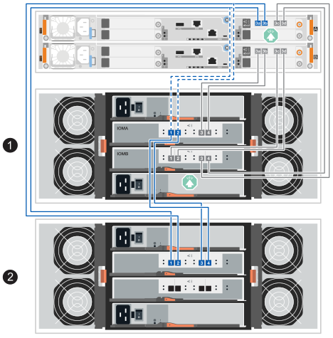

. 在 SANtricity System Manager 中，按一下功能表：Hardware [Controllers and components]。
+

NOTE: 如果您要新增第二個 SAS 擴充櫃，則在此程序的這個階段，您只有一條通往控制器機櫃的作用中路徑。

. 視需要向下捲動以查看新儲存系統中的所有磁碟機櫃。如果未顯示新磁碟機櫃、請解決連線問題。
. 選取新磁碟機櫃的* ESM/IOM*圖示。
+
image::../media/sam1130_ss_hardware_iom_icon.gif[ESM/IOM 圖示]

+
「*機櫃元件設定*」對話方塊隨即出現。

. 在「*機架元件設定*」對話方塊中選取「* ESM/IOM*」索引標籤。
. 選擇*顯示更多選項*、然後確認下列事項：
+
** 如果您要新增初始 SAS 擴充櫃，則會列出 IOM/ESM A 和 IOM/ESM B。如果您要新增第二個 SAS 擴充櫃，則會列出 IOM/ESM A。
** SAS-3磁碟機櫃的目前資料傳輸率為12 Gbps。
** 卡片通訊正常。

. 如果您要新增第二個 SAS 擴充櫃，請如下重新連接 B 側控制器到機櫃的連線，並新增 B 側機櫃到機櫃的連線；否則，請前往步驟 10。
+
.. 將纜線從機櫃 1 的 IOMB 連接埠 1 拔下，然後將其重新連接至機櫃 2 的 IOMB 連接埠 1。
.. 將纜線從機櫃 1 IOMB 連接埠 2 拔除，然後將其重新連接至機櫃 2 IOMB 連接埠 2。
.. 將機櫃 1 的 IOMB 連接埠 1 連接到機櫃 2 的 IOMB 連接埠 3。
.. 將機櫃 1 的 IOMB 連接埠 2 連接到機櫃 2 的 IOMB 連接埠 4。
+
完成 B 側連接的重新佈線後，佈線應如下圖所示：

+
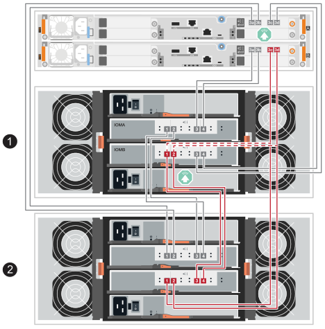

. 如果您要新增第二個 SAS 擴充櫃，完成兩個機櫃的重新佈線後，佈線應如下所示：
+

NOTE: 如果您要將第三個機櫃熱新增至兩個機櫃的堆疊中，則佈線應與新系統安裝的 _為 SAS 機櫃連線佈線_ 區段的 link:../install-hw-ef50-ef80/install-cable.html#step-3-cable-the-sas-shelf-connections["選項 2：三個 DE460C 機櫃索引標籤"^] 中的插圖類似。

+
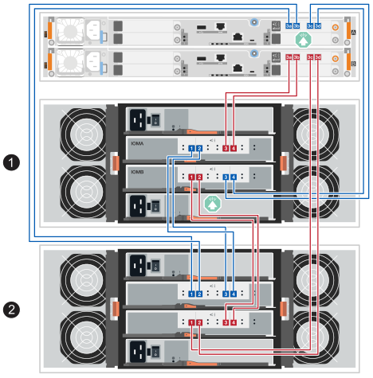

. 如果尚未選取、請選取「*機架元件設定*」對話方塊中的「* ESM/IOM*」索引標籤、然後選取「*顯示更多選項*」。驗證卡通訊是否為*是*。
+

NOTE: Optimal（最佳）狀態表示新磁碟機櫃相關的備援遺失錯誤已解決、且儲存系統已穩定。

--
.連接 E2800 或 E5700 的磁碟機櫃
--
您將磁碟機櫃連接至控制器A、確認IOM狀態、然後將磁碟機櫃連接至控制器B

.步驟
. 將磁碟機櫃連接至控制器A
+
下圖顯示其他磁碟機櫃與控制器A之間的連線範例若要在您的機型上找到連接埠、請參閱 https://hwu.netapp.com/Controller/Index?platformTypeId=2357027["Hardware Universe"^]。

+
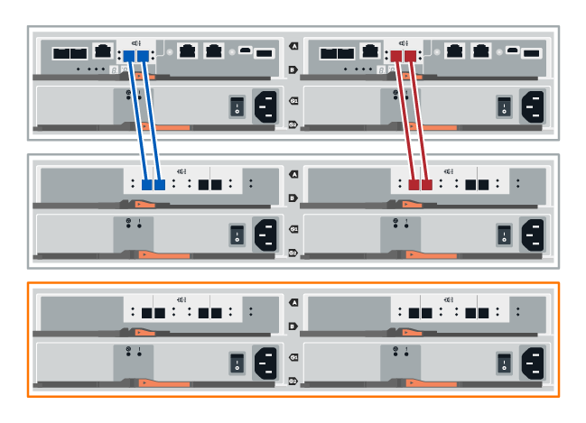

+
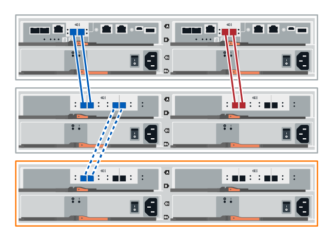

. 在「系統管理程式」中、按一下「*硬體*」SANtricity 。
+

NOTE: 在此程序中、您只有一個作用中路徑可通往控制器機櫃。

. 視需要向下捲動以查看新儲存系統中的所有磁碟機櫃。如果未顯示新磁碟機櫃、請解決連線問題。
. 選取新磁碟機櫃的* ESM/IOM*圖示。
+
image::../media/sam1130_ss_hardware_iom_icon.gif[ESM/IOM 圖示]

+
「*機櫃元件設定*」對話方塊隨即出現。

. 在「*機架元件設定*」對話方塊中選取「* ESM/IOM*」索引標籤。
. 選擇*顯示更多選項*、然後確認下列事項：
+
** 列出了IOM / esm A。
** SAS-3磁碟機櫃的目前資料傳輸率為12 Gbps。
** 卡片通訊正常。

. 從控制器B拔下所有擴充纜線
. 將磁碟機櫃連接至控制器B
+
下圖顯示其他磁碟機櫃與控制器B之間的連線範例若要在您的機型上找到連接埠、請參閱 https://hwu.netapp.com/Controller/Index?platformTypeId=2357027["Hardware Universe"^]。

+
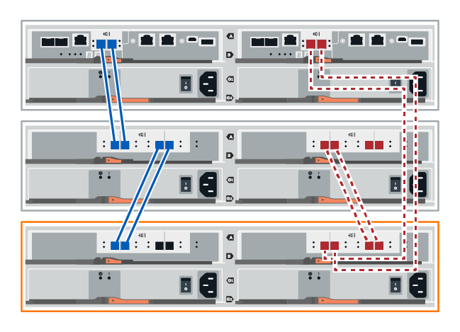

. 如果尚未選取、請選取「*機架元件設定*」對話方塊中的「* ESM/IOM*」索引標籤、然後選取「*顯示更多選項*」。驗證卡通訊是否為*是*。
+

NOTE: Optimal（最佳）狀態表示新磁碟機櫃相關的備援遺失錯誤已解決、且儲存系統已穩定。

--
.連接 EF300 或 EF600 的磁碟機櫃
--
您將磁碟機櫃連接至控制器A、確認IOM狀態、然後將磁碟機櫃連接至控制器B

.開始之前
* 您已將韌體更新為最新版本。若要更新韌體、請遵循中的指示 link:../upgrade-santricity/index.html["升級SANtricity 作業系統"]。

.步驟
. 從IOM12連接埠1和2拔下堆疊中前一個機櫃的兩條A側控制器纜線、然後將它們連接至新的IOM12連接埠1和2。
+
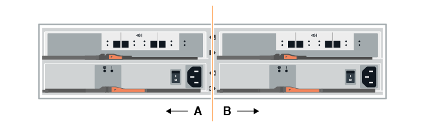

. 將纜線連接至A側IOM12連接埠、從新機櫃連接至上一個機櫃IOM12連接埠1和2。
+
下圖顯示額外磁碟機櫃與上一個最後一個磁碟櫃之間的側邊連線範例。若要在您的機型上找到連接埠、請參閱 https://hwu.netapp.com/Controller/Index?platformTypeId=2357027["Hardware Universe"^]。

+
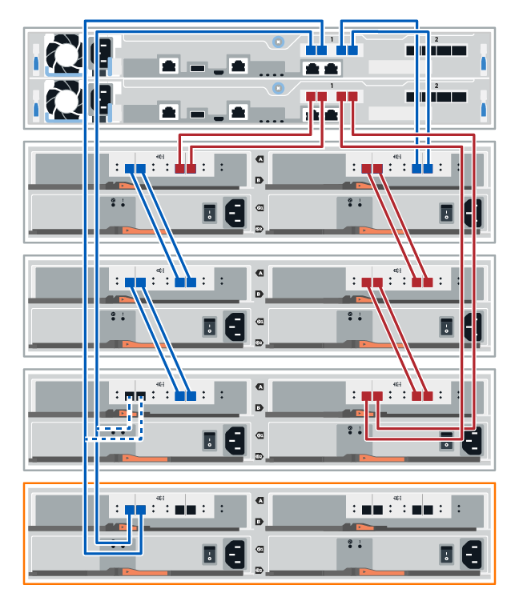

+
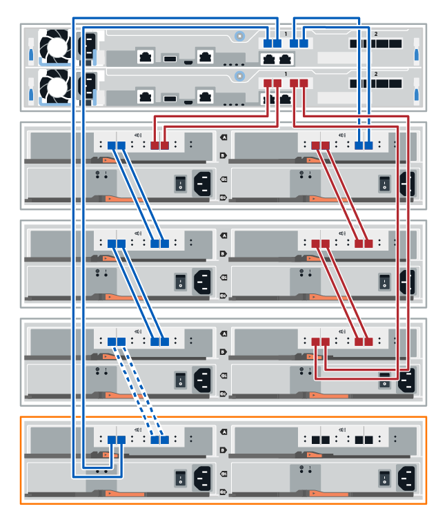

. 在 SANtricity System Manager 中，按一下功能表：Hardware [Controllers and components]。
+

NOTE: 在此程序中、您只有一個作用中路徑可通往控制器機櫃。

. 視需要向下捲動以查看新儲存系統中的所有磁碟機櫃。如果未顯示新磁碟機櫃、請解決連線問題。
. 選取新磁碟機櫃的* ESM/IOM*圖示。
+
image::../media/sam1130_ss_hardware_iom_icon.gif[ESM/IOM 圖示]

+
「*機櫃元件設定*」對話方塊隨即出現。

. 在「*機架元件設定*」對話方塊中選取「* ESM/IOM*」索引標籤。
. 選擇*顯示更多選項*、然後確認下列事項：
+
** 列出了IOM / esm A。
** SAS-3磁碟機櫃的目前資料傳輸率為12 Gbps。
** 卡片通訊正常。

. 從IOM12連接埠1和2拔下B側控制器纜線、從堆疊中的上一個最後一個機櫃拔下、然後將它們連接至新的機櫃IOM12連接埠1和2。
. 將纜線連接至B側IOM12連接埠、從新機櫃連接至上一個機櫃IOM12連接埠1和2。
+
下圖顯示額外磁碟機櫃與上一個最後一個磁碟櫃之間的B側連線範例。若要在您的機型上找到連接埠、請參閱 https://hwu.netapp.com/Controller/Index?platformTypeId=2357027["Hardware Universe"^]。

+
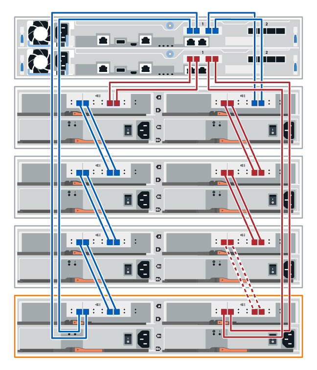

. 如果尚未選取、請選取「*機架元件設定*」對話方塊中的「* ESM/IOM*」索引標籤、然後選取「*顯示更多選項*」。驗證卡通訊是否為*是*。
+

NOTE: Optimal（最佳）狀態表示新磁碟機櫃相關的備援遺失錯誤已解決、且儲存系統已穩定。

--
.連接 E4000 的磁碟機櫃
--
您將磁碟機櫃連接至控制器A、確認IOM狀態、然後將磁碟機櫃連接至控制器B

.步驟
. 將磁碟機櫃連接至控制器A
+
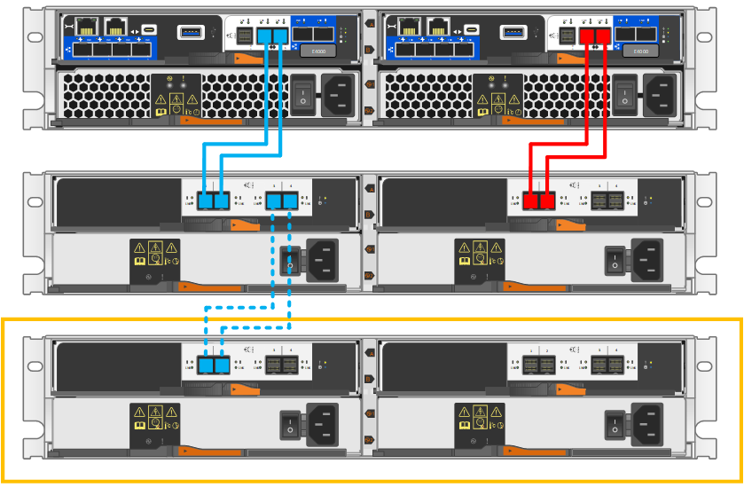

. 在 SANtricity System Manager 中，按一下功能表：Hardware [Controllers and components]。
+

NOTE: 在此程序中、您只有一個作用中路徑可通往控制器機櫃。

. 視需要向下捲動以查看新儲存系統中的所有磁碟機櫃。如果未顯示新磁碟機櫃、請解決連線問題。
. 選取新磁碟機櫃的* ESM/IOM*圖示。
+
image::../media/sam1130_ss_hardware_iom_icon.gif[IOM 硬體圖示]

+
「*機櫃元件設定*」對話方塊隨即出現。

. 在「*機架元件設定*」對話方塊中選取「* ESM/IOM*」索引標籤。
. 選擇*顯示更多選項*、然後確認下列事項：
+
** 列出了IOM / esm A。
** SAS-3磁碟機櫃的目前資料傳輸率為12 Gbps。
** 卡片通訊正常。

. 從控制器B拔下所有擴充纜線
. 將磁碟機櫃連接至控制器B
+
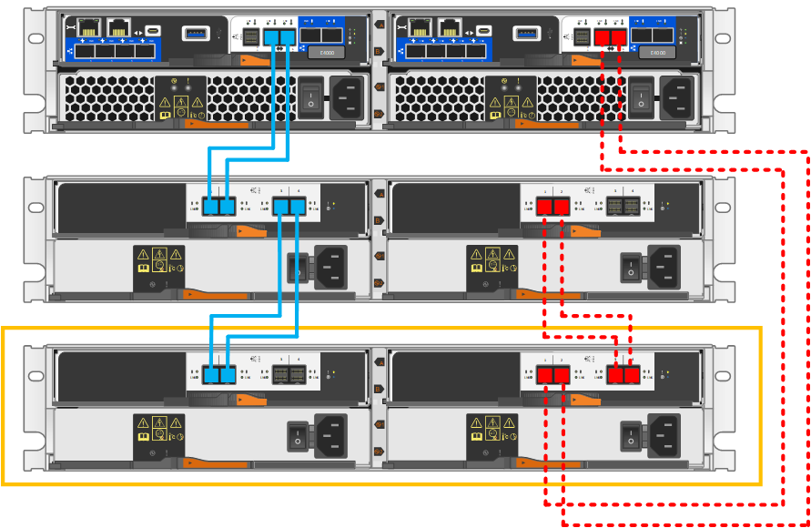

. 如果尚未選取、請選取「*機架元件設定*」對話方塊中的「* ESM/IOM*」索引標籤、然後選取「*顯示更多選項*」。驗證卡通訊是否為*是*。
+

NOTE: Optimal（最佳）狀態表示新磁碟機櫃相關的備援遺失錯誤已解決、且儲存系統已穩定。

--
====

[[step-4-assign-drive-shelf-ids]]
== 步驟 4：指派磁碟機機櫃 ID

開啟機櫃電源，然後指派唯一的機櫃 ID 給每個機櫃。

.關於這項工作
* 為每個機櫃分配一個唯一的機櫃 ID，可確保該機櫃在您的儲存系統中是獨立的。
+
有效的機櫃 ID 為 01 至 99。

+
整合在控制器中的內部機櫃（儲存設備）會指派固定的機櫃 ID 00。

* 您必須將機櫃斷電重新啟動（關閉 SAS 機櫃每個電源供應器上的電源開關，等待至少 10 秒鐘，然後再重新開啟電源），機櫃 ID 才能生效。

.步驟
. 移除左側端蓋，即可存取面板上的橘色機櫃 ID 按鈕。
+
image::../media/drw_shelf_id_sas_ieops-2187.svg[更改 SAS 機櫃 ID]

+
[cols="20%,80%"]
|===

 a| 
image::../media/icon_round_1.png[圖說編號 1]
 a| 
機櫃端蓋

 a| 

 a| 
機櫃面板

 a| 
image::../media/icon_round_3.png[［標註編號 3]
 a| 
機櫃 ID 按鈕

 a| 
image::../media/icon_round_4.png[［標註編號 4]
 a| 
機櫃 ID 編號

|===
. 更改機櫃 ID 的第一個數字：
+
.. 按住機櫃 ID 按鈕，直到數位顯示器上的第一個數字閃爍，然後放開按鈕。
+
數字閃爍最多可能需要 15 秒。這會啟動機櫃 ID 編程模式。

+

NOTE: 如果 ID 超過 15 秒才開始閃爍，請再次按住機櫃 ID 按鈕，確保將其完全按下。

.. 按下並版本機櫃 ID 按鈕，即可前進編號，直到達到 0 到 9 之間的所需編號。
+
每次按下和版本的持續時間最短可至一秒。

+
第一個數字持續閃爍。

. 更改機櫃 ID 的第二個數字：
+
.. 按住按鈕，直到數位顯示器上的第二個數字閃爍。
+
數字閃爍最多可能需要三秒鐘。

+
數位顯示器上的第一個數字停止閃爍。

.. 按下並版本機櫃 ID 按鈕，即可前進編號，直到達到 0 到 9 之間的所需編號。
+
第二個數字持續閃爍。

. 鎖定所需的編號，按住機櫃 ID 按鈕直到第二個數字停止閃爍，即可退出編程模式。
+
數字停止閃爍最多可能需要三秒鐘。

+
數位顯示器上的兩個數字開始閃爍，大約五秒鐘後琥珀色 LED 燈亮起，提醒您待處理的機櫃 ID 尚未生效。

. 將機櫃斷電重啟至少 10 秒鐘，以使機櫃 ID 生效。
+
.. 關閉每個電源供應器上的電源開關。
.. 請等待 10 秒。
.. 打開每個電源供應上的電源開關，以完成電源循環。
+
電源供應接通時，雙色 LED 指示燈應亮起綠色。

. 更換左側端蓋。

[[step-5-complete-the-hot-add]]
== 步驟 5：完成熱新增

您可以檢查是否有任何錯誤、並確認新新增的磁碟機櫃使用最新的韌體來完成熱新增功能。

.步驟
. 在「系統管理程式」中、按一下「*首頁*」SANtricity 。
. 如果頁面頂端的中央顯示標有*從問題中恢復*的連結、請按一下連結、並解決Recovery Guru中指出的任何問題。
. 在 SANtricity System Manager 中，按一下功能表：Hardware[Controllers and components]，然後視需要向下捲動，以查看新增的磁碟機櫃。
. 對於先前安裝在不同儲存系統中的磁碟機、請在新安裝的磁碟機櫃中一次新增一個磁碟機。在插入下一個磁碟機之前、請等待每個磁碟機都能被辨識。
+
當儲存系統辨識磁碟機時、「*硬體*」頁面中的磁碟機插槽呈現為藍色矩形。

. 選取*支援*>*支援中心*>*支援資源*索引標籤。
. 按一下「*軟體與韌體詳細目錄*」連結、檢查新磁碟機櫃上安裝的IOM / esm韌體版本和磁碟機韌體版本。
+

NOTE: 您可能需要向下捲動頁面、才能找到此連結。

. 如有必要、請升級磁碟機韌體。
+
除非您已停用升級功能、否則IOM / ESm韌體會自動升級至最新版本。

.接下來呢？
熱新增程序已完成。您可以恢復正常作業。
