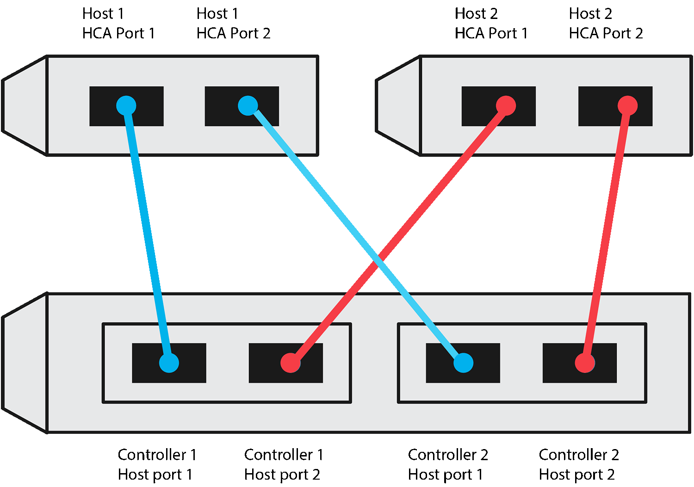
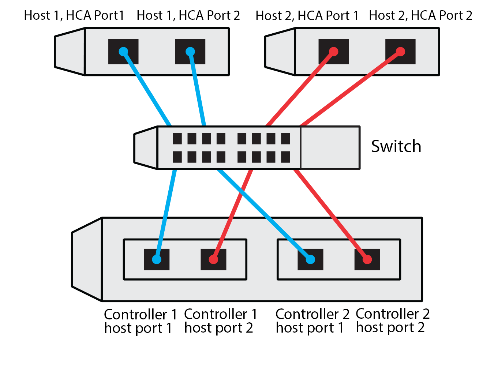

= E 系列 Linux 主機 NVMe over TCP 組態工作表
:allow-uri-read: 
:icons: font
:imagesdir: ../media/

[role="lead"]
您可以產生並列印此頁面的 PDF 文件，然後使用下列工作表記錄 NVMe over TCP 儲存組態資訊。您需要這些資訊來執行配置工作。

[[direct-connect-topology]]
== 直接連線拓撲

在直連拓撲中，一個或多個主機直接連接到子系統。在 SANtricity 作業系統 11.50 版本中，我們支援每個主機到子系統控制器的單一連接，如下圖所示。在此組態中，每個主機的一個 NIC（網路介面卡）連接埠應與其連接的 E 系列控制器連接埠位於相同子網路，但與另一個 NIC 連接埠位於不同的子網路。

滿足需求的範例組態包括四個子網路、如下所示：

* 子網路 1：主機 1 NIC 連接埠 1 和控制器 1 主機連接埠 1
* 子網路 2：主機 1 NIC 連接埠 2 和控制器 2 主機連接埠 1
* 子網路 3：主機 2 NIC 連接埠 1 和控制器 1 主機連接埠 2
* 子網路 4：主機 2 NIC 連接埠 2 和控制器 2 主機連接埠 2

[[switch-connect-topology]]
== 交換器連線拓撲

在網路拓撲中、會使用一或多個交換器。請參閱 https://mysupport.netapp.com/matrix["NetApp 互通性對照表工具"^] 以取得支援的交換器清單。

[[host-identifiers]]
== 主機識別碼

從每個主機找出並記錄啟動器NQN。

|===
| 主機連接埠連線 | 軟體啟動器NQN 

 a| 
主機（啟動器）1.
 a| 
{nbsp}

 a| 
{nbsp}
 a| 
{nbsp}

 a| 
主機（啟動器）2.
 a| 
{nbsp}

 a| 
{nbsp}
 a| 
{nbsp}

 a| 
{nbsp}
 a| 
{nbsp}

|===

[[target-nqn]]
== 目標NQN

記錄儲存陣列的目標NQN。

|===
| 陣列名稱 | 目標NQN 

 a| 
陣列控制器（目標）
 a| 

|===

[[target-nqns]]
== 目標NQN

記錄陣列連接埠要使用的NQN。

|===
| 陣列控制器（目標）連接埠連線 | NQN 

 a| 
控制器A、連接埠1
 a| 

 a| 
控制器B、連接埠1
 a| 

 a| 
控制器A、連接埠2
 a| 

 a| 
控制器B、連接埠2
 a| 

|===

[[mapping-host-name]]
== 對應主機名稱

NOTE: 對應主機名稱會在工作流程期間建立。

|===

 a| 
對應主機名稱
 a| 

 a| 
主機作業系統類型
 a| 

|===