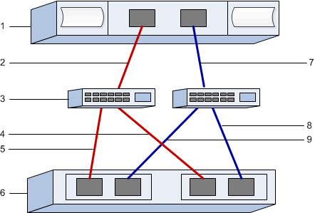

= 在 E 系列中設定 VMware 的 FC 交換器和主機識別符
:allow-uri-read: 
:icons: font
:imagesdir: ../media/

[role="lead"]
對於 Fibre Channel 傳輸協定（FCP），您設定交換器並決定主機連接埠識別碼。

NOTE: 使用 4096 位元組磁碟機時，必須將 Volume 設定為使用 512 位元組模擬（512e），以確保與 VMware 相容。如需將 Volume 設定為使用 512 位元組模擬（512e）的詳細資訊，請參閱 SANtricity System Manager 線上說明。

[[step-1-record-your-configuration]]
== 步驟 1：記錄您的組態

您可以產生並列印此頁面的 PDF 文件，然後使用下列工作表記錄 FC 儲存組態資訊。您在執行配置工作時需要這些資訊。

圖中顯示主機在兩個區域中連接至 E 系列儲存陣列。一個區域以紅線標示；另一個區域以藍線標示。每個區域至少包含一個啟動器連接埠和一半的目標連接埠。主機和 / 或控制器連接埠的數量將因主機匯流排介面卡的數量與控制器型號而異。您可能會有更多可用的連接埠（每個控制器最多 12 個）。視需要列印額外的 PDF。

[[host-identifiers]]
=== 主機識別碼

|===
| 標註編號 | 主機（啟動器）連接埠連線 | WWPN 

 a| 
1.
 a| 
主機
 a| 
_不適用_

 a| 
2.
 a| 
主機連接埠0至FC交換器區域0
 a| 

 a| 
7.
 a| 
主機連接埠1至FC交換器區域1
 a| 

|===

[[target-identifiers]]
=== 目標識別碼

|===
| 標註編號 | 陣列控制器（目標）連接埠連線 | WWPN 

 a| 
3.
 a| 
交換器
 a| 
_不適用_

 a| 
6.
 a| 
陣列控制器（目標）
 a| 
_不適用_

 a| 
5.
 a| 
控制器A、連接埠1至FC交換器1
 a| 

 a| 
5.
 a| 
控制器 A，連接埠 2 連接至 FC 交換器 1
 a| 

 a| 
9.
 a| 
控制器 A，連接埠 3 連接至 FC 交換器 2
 a| 

 a| 
9.
 a| 
控制器 A，連接埠 4 連接至 FC 交換器 2
 a| 

 a| 
4.
 a| 
控制器B、連接埠1至FC交換器1
 a| 

 a| 
4.
 a| 
控制器 B，連接埠 2 連接至 FC 交換器 1
 a| 

 a| 
8.
 a| 
控制器 B，連接埠 3 連接至 FC 交換器 2
 a| 

 a| 
8.
 a| 
控制器 B，連接埠 4 連接至 FC 交換器 2
 a| 

|===

[[host-mapping-information]]
=== 主機對應資訊

[cols="35h,~"]
|===
| 對應主機名稱 |  

| 主機作業系統類型 |  
|===

[[step-2-determine-the-host-port-wwpns]]
== 步驟 2：確定主機連接埠 WWPN

若要設定FC分區、您必須決定每個啟動器連接埠的全球連接埠名稱（WWPN）。

.步驟
. 使用 SSH 或 ESXi shell 連線到 ESXi 主機。若要啟用 ESXi shell，請參閱 https://knowledge.broadcom.com/external/article/311213/using-esxi-shell-in-esxi.html["在 ESXi 中使用 ESXi Shell"^]。
. 執行下列命令：
+
[listing]
----
esxcli storage core adapter list
----
. 記錄啟動器 WWPN 識別碼（UID，格式為 fc.WWNN:WWPN）。輸出結果將類似於以下範例：
+
[listing]
----
HBA Name  Driver    Link State  UID                                   Capabilities         Description
--------  --------  ----------  ------------------------------------  -------------------  -----------
vmhba4    lpfc      link-up     fc.200070b7e4395530:100070b7e4395530  Second Level Lun ID  (0000:5e:00.0) Emulex Corporation Emulex LPe35000/LPe36000 Fibre Channel Adapter
vmhba5    lpfc      link-up     fc.200070b7e4395531:100070b7e4395531  Second Level Lun ID  (0000:5e:00.1) Emulex Corporation Emulex LPe35000/LPe36000 Fibre Channel Adapter
vmhba64   lpfc      link-up     fc.200070b7e4395530:100070b7e4395530                       (0000:5e:00.0) Emulex Corporation Emulex LPe35000/LPe36000 Fibre Channel Adapter
vmhba65   lpfc      link-up     fc.200070b7e4395531:100070b7e4395531                       (0000:5e:00.1) Emulex Corporation Emulex LPe35000/LPe36000 Fibre Channel Adapter

----

在上面的範例中，vmhba4 和 vmhba64 以及 vmhba5 和 vmhba65 的 UID 相同。這對於同時支援 FCP 和 NVMe over FC 的 FC 介面卡來說是正常的。請記錄每個唯一的 WWPN。

NOTE: 另一個命令選項是 `esxcli storage san fc list`。這將顯示更多詳細資訊以及以冒號分隔的十六進位格式的 WWPN。

[[step-3-configure-the-fc-switches]]
== 步驟 3：設定 FC 交換器

設定（分區）光纖通道（FC）交換器可讓主機連線至儲存陣列、並限制路徑數量。您可以使用交換器的管理介面來分區交換器。

.開始之前
請確定您擁有下列項目：

* 交換器的系統管理員認證。
* 連接到交換器的每個主機啟動器埠和每個控制器目標埠的 WWPN。

NOTE: 廠商的HBA公用程式可用來升級及取得HBA的特定資訊。如需如何取得HBA公用程式的指示、請參閱廠商網站的支援區段。

.關於這項工作
每個啟動器連接埠都必須位於具有所有對應目標連接埠的個別區域中。如需交換器分區的詳細資訊、請參閱交換器廠商的文件。

.步驟
. 登入FC交換器管理程式、然後選取分區組態選項。
. 建立新的區域、其中包含第一個主機啟動器連接埠、也包含所有連接到啟動器所在FC交換器的目標連接埠。
. 為交換器中的每個FC主機啟動器連接埠建立其他區域。
. 儲存區域、然後啟動新的分區組態。

請查閱交換器廠商的文件，以取得有關設定區域的詳細說明。
