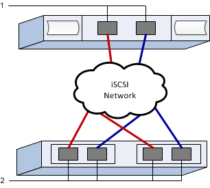

= 在 E 系列中為 VMware 設定 iSCSI 交換器和連網
:allow-uri-read: 
:experimental: 
:icons: font
:imagesdir: ../media/

[role="lead"]
對於iSCSI傳輸協定、您可以在陣列端和主機端設定交換器和網路。然後驗證IP網路連線。

NOTE: 使用 4096 位元組磁碟機時，必須將 Volume 設定為使用 512 位元組模擬（512e），以確保與 VMware 相容。如需將 Volume 設定為使用 512 位元組模擬（512e）的詳細資訊，請參閱 SANtricity System Manager 線上說明。

[[step-1-record-your-configuration]]
== 步驟 1：記錄您的組態

您可以產生並列印此頁面的 PDF 文件，然後使用下列工作表記錄特定於協定的儲存組態資訊。您在執行配置任務時需要這些資訊。

圖中顯示了一台主機連接到 E 系列儲存陣列，該陣列透過 VLAN 和/或獨立子網路進行隔離。藍線表示一個 VLAN/子網路，紅線表示另一個 VLAN/子網路。每個 VLAN/子網路至少包含一個啟動器連接埠和一半的目標連接埠。主機和/或控制器連接埠的數量取決於網路介面的數量和控制器型號。您可能擁有更多連接埠（每個控制器最多 6 個）。

[[host-mapping-information]]
=== 主機對應資訊

[cols="35h,~"]
|===
| 對應主機名稱 |  

| 主機作業系統類型 |  

| 主機 IQN |  

| 目標IQN |  
|===

[[step-2-configure-the-switches]]
== 步驟 2：設定交換器

您可以根據廠商的iSCSI建議來設定交換器。這些建議可能同時包含組態指令和程式碼更新。

.開始之前
請確定您擁有下列項目：

* 兩個獨立的網路提供高可用度。請確定您將iSCSI流量隔離至不同的網路區段。
* 啟用 *端對端* 的發送和接收硬體流程控制。
* 停用優先順序流程控制。
* 如果適用，請啟用巨型訊框（建議）。

NOTE: 控制器的交換器連接埠不支援連接埠通道/LACP。不建議使用主機端LACP；多重路徑可提供相同或更好的效益。

.步驟
請參閱交換器廠商的文件。

[[step-3-configure-networking]]
== 步驟 3：設定連網

您可以根據資料儲存需求、以多種方式設定iSCSI網路。如需為環境選擇最佳組態的秘訣、請洽詢您的網路管理員。

.開始之前
請確定您擁有下列項目：

* 啟用 *端對端* 的發送和接收硬體流程控制。
* 停用優先順序流程控制。
* 如果適用，請啟用巨型訊框（建議）。
+
如果出於效能考量而在 IP SAN 中使用巨型訊框，請務必將陣列、交換器和主機設定為使用巨型訊框。如需如何在主機和交換器上啟用巨型訊框的資訊，請參閱您的作業系統和交換器文件。若要在陣列上啟用巨型訊框，請完成步驟 4 中的步驟。

.關於這項工作
在規劃 iSCSI 連網時，請記住， https://configmax.broadcom.com/guest["VMware 組態上限指南"^] 指出每個 LUN 最多支援 32 條 iSCSI 路徑，並且每台伺服器最多可以與軟體 iSCSI 堆疊關聯或綁定連接埠的網路卡數量為 8 個。您必須考慮此要求，以避免設定過多的路徑。

根據預設、當您不使用iSCSI連接埠繫結時、VMware iSCSI軟體啟動器會針對每個iSCSI目標建立單一工作階段。

NOTE: VMware iSCSI 連接埠綁定是一項功能，它會強制所有綁定的 VMkernel 連接埠登入已設定網路區段上所有可存取的目標連接埠。它適用於為 iSCSI 目標提供單一網路位址的陣列。NetApp 建議不要使用 iSCSI 連接埠綁定。如需其他資訊，請參閱 https://techdocs.broadcom.com/us/en/vmware-cis/vsphere/vsphere/9-1/vsphere-storage/configuring-iscsi-and-iser-adapters-and-storage-with-esxi/setting-up-network-for-iscsi-and-iser-with-esxi/best-practices-for-configuring-networking-with-software-iscsi.html["在 ESX/ESXi 中使用軟體 iSCSI 連接埠綁定的最佳實務"^]。如果 ESXi 主機連接到其他廠商的儲存設備，NetApp 建議您使用分隔的 iSCSI VMkernel 連接埠，以避免與連接埠綁定發生衝突。

為確保良好的多重路徑組態、iSCSI網路可使用多個網路區段。在一個網路區段上、至少放置一個主機端連接埠和每個陣列控制器的一個連接埠、並在另一個網路區段上放置一組相同的主機端連接埠和陣列端連接埠。如有可能、請使用多個乙太網路交換器來提供額外的備援。

.步驟
請參閱交換器廠商的文件。

NOTE: 許多網路交換器必須設定在超過9、000位元組的IP負荷上。如需詳細資訊、請參閱交換器文件。

[[step-4-configure-array-side-networking]]
== 步驟 4：設定陣列側連網

您可以使用SANtricity 支援支援系統的圖形使用者介面、在陣列端設定iSCSI網路。

.開始之前
請確定您擁有下列項目：

* 其中一個儲存陣列控制器的IP位址或網域名稱。
* 系統管理員GUI的密碼、或角色型存取控制（RBAC）或LDAP及目錄服務的密碼、已設定為適當的儲存陣列安全存取。如SANtricity 需存取管理的詳細資訊、請參閱《支援系統》線上說明。

.關於這項工作
本工作說明如何從「硬體」頁面存取iSCSI連接埠組態。您也可以從功能表：系統[設定>設定iSCSI連接埠]存取組態。

NOTE: 有關如何在 VMware 組態中設定陣列端網路的詳細資訊，請參閱以下技術報告： https://www.netapp.com/pdf.html?item=/media/17017-tr4789.pdf["《VMware組態指南：E系列SANtricity 的iSCSI與ESXi 6.x和7.x整合》"^]。

.步驟
. 在瀏覽器中輸入下列URL：「+https://<DomainNameOrIPAddress>+`」
+
「IPAddress」是其中一個儲存陣列控制器的位址。

+
第一次SANtricity 在尚未設定的陣列上開啟時、會出現「Set Administrator Password（設定管理員密碼）」提示字元。角色型存取管理可設定四種本機角色：管理、支援、安全性及監控。後三個角色的隨機密碼是無法猜測的。設定管理員角色的密碼之後、您可以使用管理員認證來變更所有密碼。如SANtricity 需四種本機使用者角色的詳細資訊、請參閱《支援系統》線上說明。

. 在Set Administrator Password（設定管理員密碼）和Confirm Password（確認密碼）欄位中輸入管理員角色的System Manager密碼、然後按一下* Set Password（設定密碼）*。
+
如果沒有設定任何集區、Volume 群組、工作負載或通知，則會啟動設定精靈。

. 關閉設定精靈。
+
稍後您將使用精靈來完成其他設定工作。

. 選取*硬體*。
. 如果圖形顯示磁碟機、請按一下*顯示磁碟櫃背面*。
+
圖形會變更、以顯示控制器而非磁碟機。

. 按一下要設定iSCSI連接埠的控制器。
+
此時會出現控制器的內容功能表。

. 選取*設定iSCSI連接埠*。
+
此時將打開Configure iSCSI Portes（配置iSCSI端口）對話框。

. 在下拉式清單中、選取您要設定的連接埠、然後按一下「*下一步*」。
. 選取組態連接埠設定、然後按一下「*下一步*」。
+
若要查看所有連接埠設定、請按一下對話方塊右側的*顯示更多連接埠設定*連結。

+
|===
| 連接埠設定 | 說明 

 a| 
已設定乙太網路連接埠速度
 a| 
選擇所需速度。下拉清單中顯示的選項取決於您的網路可支援的最大速度（例如，25 Gbps）。

NOTE: 控制器上可用的 iSCSI 主機介面卡不會自動協商速度。您必須將每個連接埠的速度設定為 1 Gb、10 Gb 或 25 Gb。所有連接埠都必須設定為相同的速度。

 a| 
啟用IPV4 /啟用IPv6
 a| 
選取一個或兩個選項、以啟用對IPv4和IPv6網路的支援。

 a| 
TCP接聽連接埠（按一下*顯示更多連接埠設定*即可取得）。
 a| 
如有必要、請輸入新的連接埠號碼。

接聽連接埠是控制器用來接聽來自主機iSCSI啟動器之iSCSI登入的TCP連接埠號碼。預設的接聽連接埠為3260。您必須輸入3260或49152到65535.之間的值。

 a| 
MTU大小（按一下*顯示更多連接埠設定*即可取得）。
 a| 
如有必要、請為最大傳輸單元（MTU）輸入新的位元組大小。

預設的最大傳輸單元（MTU）大小為每個訊框 1500 位元組。您必須輸入 1500 到 9000 之間的值。若要啟用巨型訊框，請將此值設為 9000 位元組。

 a| 
啟用ICMP Ping回應
 a| 
選取此選項可啟用網際網路控制訊息傳輸協定（ICMP）。網路電腦的作業系統會使用此傳輸協定來傳送訊息。這些ICMP訊息可判斷主機是否可連線、以及從該主機取得封包所需的時間。

|===
+
如果您選取*啟用IPV4、則會在您按一下*下一步*之後、開啟一個對話方塊、供您選取IPV4設定。如果您選取*啟用IPv6 *、則會在您按一下*下一步*之後、開啟一個對話方塊來選取IPv6設定。如果您同時選取這兩個選項、則會先開啟[IPV4設定]對話方塊、然後按一下[* Next*（*下一步*）]之後、隨即開啟[IPv6設定]對話方塊。

. 自動或手動設定IPv6和/或IPv6設定。若要查看所有連接埠設定、請按一下對話方塊右側的*顯示更多設定*連結。
+
|===
| 連接埠設定 | 說明 

 a| 
自動取得組態
 a| 
選取此選項可自動取得組態。

 a| 
手動指定靜態組態
 a| 
選取此選項、然後在欄位中輸入靜態位址。對於IPV4、請加入網路子網路遮罩和閘道。對於IPv6、請包含可路由的IP位址和路由器IP位址。

|===
. 單擊*完成*。
. 關閉System Manager。

[[step-5-configure-host-side-networking]]
== 步驟 5：設定主機端連網

在主機端設定iSCSI網路功能可讓VMware iSCSI啟動器與陣列建立工作階段。

.關於這項工作
此工作在主機端設定 iSCSI 連網，並與儲存陣列建立 iSCSI 工作階段。

完成此工作之後、主機會設定一個vSwitch、其中包含VMkernel連接埠和兩個vmnics。

如需為 VMware 設定 iSCSI 連網的其他資訊，請參閱 https://techdocs.broadcom.com/us/en/vmware-cis/vsphere/vsphere/9-1/vsphere-storage/configuring-iscsi-and-iser-adapters-and-storage-with-esxi.html["使用 ESXi 設定 iSCSI 介面卡和儲存設備"^]。

NOTE: 在此過程中，請記錄新增軟體 iSCSI 介面卡的 iSCSI 限定名稱（IQN）。稍後設定主機對應時將需要此資訊。

.開始之前
請確定您擁有下列項目：

* 已設定將用於承載 iSCSI 儲存設備流量的交換器。
* 在交換器上啟用 *端對端* 的傳送與接收硬體流程控制。
* 交換器上的優先權流程控制已停用。
* 陣列端 iSCSI 組態完成。
* 至少兩個主機網路卡埠用於 iSCSI 流量。

.步驟
. 使用 vSphere 用戶端或 vSphere Web 用戶端執行主機端組態。請參閱 https://techdocs.broadcom.com/us/en/vmware-cis/vsphere/vsphere/9-1/vsphere-storage/configuring-iscsi-and-iser-adapters-and-storage-with-esxi.html["使用 ESXi 設定 iSCSI 介面卡和儲存設備"^]。
+
介面功能各不相同、實際工作流程也各不相同。

. 設定 iSCSI 網路。請參閱 https://techdocs.broadcom.com/us/en/vmware-cis/vsphere/vsphere/9-1/vsphere-storage/configuring-iscsi-and-iser-adapters-and-storage-with-esxi/setting-up-network-for-iscsi-and-iser-with-esxi.html["使用 ESX 設定 iSCSI 網路"^]。
+
.. 建議不要使用連接埠綁定。VMware iSCSI 連接埠綁定是一項功能，它會強制所有綁定的 VMkernel 連接埠登入已設定網段上所有可存取的目標連接埠。它適用於為 iSCSI 目標提供單一網路位址的陣列。NetApp 建議不要使用 iSCSI 連接埠綁定。如需其他資訊，請參閱 https://techdocs.broadcom.com/us/en/vmware-cis/vsphere/vsphere/9-1/vsphere-storage/configuring-iscsi-and-iser-adapters-and-storage-with-esxi/setting-up-network-for-iscsi-and-iser-with-esxi/best-practices-for-configuring-networking-with-software-iscsi.html["在 ESX/ESXi 中使用軟體 iSCSI 連接埠綁定的最佳實務"^]。如果 ESXi 主機連接到其他廠商的儲存設備，NetApp 建議您使用分隔的 iSCSI vmkernel 連接埠，以避免與連接埠綁定發生衝突。
.. NetApp 建議在 vSphere 標準交換器上使用多個介面卡對應，並利用主動/待命介面卡來提供備援。請參閱 https://techdocs.broadcom.com/us/en/vmware-cis/vsphere/vsphere/9-1/vsphere-storage/configuring-iscsi-and-iser-adapters-and-storage-with-esxi/setting-up-network-for-iscsi-and-iser-with-esxi/multiple-network-adapters-in-iscsi-or-iser-configuration.html["iSCSI 組態中的多個網路介面卡"^]。
.. 如有需要，可使用 iSCSI 啟用巨型訊框。請參閱 https://techdocs.broadcom.com/us/en/vmware-cis/vsphere/vsphere/9-1/vsphere-storage/configuring-iscsi-and-iser-adapters-and-storage-with-esxi/using-jumbo-frames-with-iscsi-and-iser.html["在 ESX 上搭配 iSCSI 使用巨型訊框"^]。

. 新增軟體 iSCSI 介面卡。請參閱 https://techdocs.broadcom.com/us/en/vmware-cis/vsphere/vsphere/9-1/vsphere-storage/configuring-iscsi-and-iser-adapters-and-storage-with-esxi/configure-the-software-iscsi-adapter-with-esxi/add-or-remove-the-software-iscsi-adapter.html["新增或移除軟體 iSCSI 介面卡"^]。
+
.. 記錄主機 IQN 並新增 iSCSI 別名（選用）。請參閱 https://techdocs.broadcom.com/us/en/vmware-cis/vsphere/vsphere/9-1/vsphere-storage/configuring-iscsi-and-iser-adapters-and-storage-with-esxi/modify-general-properties-for-iscsi-and-iser-adapters-on-esxi-hosts.html["修改 ESX 主機上 iSCSI 的一般屬性"^]。
.. 如果使用 CHAP 密碼，請設定 CHAP 參數。請參閱 https://techdocs.broadcom.com/us/en/vmware-cis/vsphere/vsphere/9-1/vsphere-storage/configuring-iscsi-and-iser-adapters-and-storage-with-esxi/configuring-chap-parameters-for-iscsi-or-iser-storage-adapters-with-esxi.html["在 ESX 主機上設定 iSCSI 介面卡的 CHAP 參數"^]。

新增成功後，可以從 vSphere Client 上的「儲存介面卡」檢視中查看連線。如果不成功，請跳至步驟 6 以驗證與連接埠的通訊並修正任何連線設定。

[[step-6-verify-ip-network-connections]]
== 步驟 6：驗證 IP 網路連線

您可以使用ping測試來驗證網際網路傳輸協定（IP）網路連線、以確保主機和陣列能夠通訊。

.步驟
. 視是否啟用巨型框架而定、在主機上執行下列其中一個命令：
+
** 如果未啟用巨型框架、請執行下列命令：
+
[listing]
----
vmkping <iSCSI_target_IP_address\>
----
** 如果啟用巨型框架、請執行有效負載大小為8、972位元組的ping命令。IP和ICMP的合併標頭為28個位元組、新增至有效負載時、等於9、000個位元組。s交換器會設定「封包大小」位元。d交換器會在IPV4封包上設定DF（請勿分段）位元。這些選項可在iSCSI啟動器與目標之間成功傳輸9、000個位元組的巨型框架。
+
[listing]
----
vmkping -s 8972 -d <iSCSI_target_IP_address\>
----
+
在此範例中、iSCSI目標IP位址為「192.0.2.8」。

+
[listing]
----
vmkping -s 8972 -d 192.0.2.8
Pinging 192.0.2.8 with 8972 bytes of data:
Reply from 192.0.2.8: bytes=8972 time=2ms TTL=64
Reply from 192.0.2.8: bytes=8972 time=2ms TTL=64
Reply from 192.0.2.8: bytes=8972 time=2ms TTL=64
Reply from 192.0.2.8: bytes=8972 time=2ms TTL=64
Ping statistics for 192.0.2.8:
  Packets: Sent = 4, Received = 4, Lost = 0 (0% loss),
Approximate round trip times in milliseconds:
  Minimum = 2ms, Maximum = 2ms, Average = 2ms
----

. 從每個主機的啟動器位址（用於iSCSI的主機乙太網路連接埠IP位址）、發出「vmkping」命令至每個控制器iSCSI連接埠。從組態中的每個主機伺服器執行此動作、視需要變更IP位址。
+

NOTE: 如果命令失敗並顯示訊息「傳送失敗（訊息太長）」、請確認主機伺服器、儲存控制器和交換器連接埠上乙太網路介面的MTU大小（巨型框架支援）。

. 如果步驟 5 的探索不成功，請返回 iSCSI 主機端連網組態程序以完成工作階段探索。

