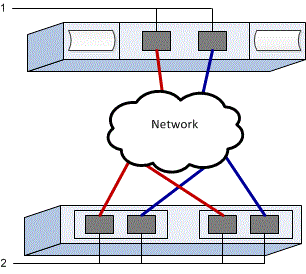

= 在 E 系列中為 VMware 設定 NVMe over TCP 交換器
:allow-uri-read: 
:icons: font
:imagesdir: ../media/

[role="lead"]
對於 NVMe over TCP 協定，您設定交換器並決定主機 NVMe Qualified Name（NQN）。

NOTE: 使用 4096 位元組磁碟機時，必須將 Volume 設定為使用 512 位元組模擬（512e），以確保與 VMware 相容。如需將 Volume 設定為使用 512 位元組模擬（512e）的詳細資訊，請參閱 SANtricity System Manager 線上說明。

[[step-1-record-your-configuration]]
== 步驟 1：記錄您的組態

您可以產生並列印此頁面的 PDF 文件，然後使用下列工作表記錄特定於協定的儲存組態資訊。您在執行配置任務時需要這些資訊。

圖中顯示了一台主機連接到 E 系列儲存陣列，該陣列透過 VLAN 和/或獨立子網路進行隔離。藍線表示一個 VLAN/子網路，紅線表示另一個 VLAN/子網路。每個 VLAN/子網路至少包含一個啟動器連接埠和一半的目標連接埠。主機和/或控制器連接埠的數量取決於網路介面的數量和控制器型號。您可能擁有更多連接埠（每個控制器最多 6 個）。

[[host-mapping-information]]
=== 主機對應資訊

[cols="35h,~"]
|===
| 對應主機名稱 |  

| 主機作業系統類型 |  

| 主機NQN |  

| 目標NQN |  
|===

[[step-2-configure-the-nvmetcp-switches]]
== 步驟 2：設定 NVMe/TCP 交換器

您根據廠商針對 NVMe over TCP 的建議設定交換器。這些建議可能包括組態指令以及程式碼更新。

.關於這項工作
本工作說明設定交換器以使用 NVMe over TCP 的一般步驟。如需特定指示，請參閱交換器廠商的文件。

.開始之前
請確定您擁有下列項目：

* 為了實現高可用度，請使用兩個分隔的網路。請確保將 NVMe over TCP 流量隔離到分隔的網段。

.步驟
請參閱交換器廠商的文件。

[[step-3-configure-networking]]
== 步驟 3：設定連網

您可以根據資料儲存設備要求，透過多種方式設定 NVMe over TCP 網路。請諮詢您的網路管理員，以取得選擇最適合您環境的組態的建議。

.關於這項工作
本工作描述設定 NVMe over TCP 網路的一般步驟。如需特定指示，請參閱交換器廠商的文件。

.開始之前
請確定您擁有下列項目：

* 交換器已設定為用於 TCP 流量。

在規劃基於 TCP 的 NVMe 連網時，請記住， https://configmax.broadcom.com/guest["VMware 組態上限指南"^] 指出每部伺服器支援的最大 TCP NVMe 啟動器連接埠數為 2。您必須考慮此要求，以避免設定過多的路徑。

為確保良好的多路徑組態，請為 NVMe over TCP 網路使用多個網段。將至少一個主機端連接埠和每個陣列控制器的至少一個連接埠放置在一個網段上，並將相同的主機端和陣列端連接埠群組放置在另一個網段上。盡可能使用多個乙太網路交換器以提供額外的備援。

.步驟
請參閱交換器廠商的文件。

[[step-4-configure-array-side-networking]]
== 步驟 4：設定陣列側連網

您可以使用 SANtricity System Manager 介面在陣列側設定 NVMe over TCP 連網。

.關於這項工作
本工作介紹如何從 SANtricity System Manager 的「控制器和元件」頁面存取 NVMe over TCP 連接埠組態。您也可以從 SANtricity System Manager 中的「設定 NVMe over TCP 連接埠」頁面存取該組態。

.開始之前
請確定您擁有下列項目：

* 其中一個儲存陣列控制器的IP位址或網域名稱。
* 已為 System Manager GUI 設定密碼，或設定了基於角色的存取控制（RBAC）或 LDAP 以及目錄服務，以便對儲存陣列進行適當的安全存取。如需 link:https://docs.netapp.com/us-en/e-series-santricity/um-certificates/overview-access-management-um.html["存取管理"^] 的詳細資訊，請參閱 SANtricity System Manager 線上說明。

.步驟
. 在瀏覽器中輸入以下 URL： https://<DomainNameOrIPAddress>[]
+
「IPAddress」是其中一個儲存陣列控制器的位址。

+
第一次SANtricity 在尚未設定的陣列上開啟時、會出現「Set Administrator Password（設定管理員密碼）」提示字元。角色型存取管理可設定四種本機角色：管理、支援、安全性及監控。後三個角色的隨機密碼是無法猜測的。設定管理員角色的密碼之後、您可以使用管理員認證來變更所有密碼。如SANtricity 需四種本機使用者角色的詳細資訊、請參閱《支援系統》線上說明。

. 在Set Administrator Password（設定管理員密碼）和Confirm Password（確認密碼）欄位中輸入管理員角色的System Manager密碼、然後按一下* Set Password（設定密碼）*。
+
如果沒有設定任何集區、Volume 群組、工作負載或通知，則會啟動設定精靈。

. 關閉設定精靈。
+
稍後您將使用精靈來完成其他設定工作。

. 選擇 *Hardware* > *Controllers and components* 。
. 按一下要設定 NVMe over TCP 連接埠的控制器。
+
此時會出現控制器的內容功能表。

. 選擇 *設定 NVMe over TCP 連接埠*。
+
「設定 NVMe over TCP 連接埠」對話方塊開啟。

. 在下拉式清單中、選取您要設定的連接埠、然後按一下「*下一步*」。
. 選取組態連接埠設定、然後按一下「*下一步*」。
+
若要查看所有連接埠設定、請按一下對話方塊右側的*顯示更多連接埠設定*連結。

+
|===
| 連接埠設定 | 說明 

 a| 
已設定乙太網路連接埠速度
 a| 
選擇所需速度。下拉清單中顯示的選項取決於您的網路可支援的最大速度（例如 200 Gb/s）。

 a| 
啟用IPV4 /啟用IPv6
 a| 
選取一個或兩個選項、以啟用對IPv4和IPv6網路的支援。

 a| 
MTU 大小（點擊「顯示更多連接埠設定」即可查看。）
 a| 
如有必要、請為最大傳輸單元（MTU）輸入新的位元組大小。

預設的最大傳輸單元 (MTU) 大小為每幀 4200 位元組。您必須輸入介於 1500 到 9000 之間的值。

|===
+
如果您選取*啟用IPV4、則會在您按一下*下一步*之後、開啟一個對話方塊、供您選取IPV4設定。如果您選取*啟用IPv6 *、則會在您按一下*下一步*之後、開啟一個對話方塊來選取IPv6設定。如果您同時選取這兩個選項、則會先開啟[IPV4設定]對話方塊、然後按一下[* Next*（*下一步*）]之後、隨即開啟[IPv6設定]對話方塊。

+
自動或手動設定IPv6和/或IPv6設定。若要查看所有連接埠設定、請按一下對話方塊右側的*顯示更多設定*連結。

+
|===
| 連接埠設定 | 說明 

 a| 
自動取得組態
 a| 
選取此選項可自動取得組態。

 a| 
手動指定靜態組態
 a| 
選取此選項、然後在欄位中輸入靜態位址。對於IPV4、請加入網路子網路遮罩和閘道。對於IPv6、請包含可路由的IP位址和路由器IP位址。

|===
. 單擊*完成*。
. 關閉System Manager。

[[step-5-configure-host-side-networking]]
== 步驟 5：設定主機端連網

在主機端設定 NVMe over TCP 連網，即可讓 VMware NVMe over TCP 儲存設備介面卡啟動器與陣列建立工作階段。

.步驟
. 識別 TCP 網路介面卡並記錄 vmnic 配對的上行鏈路。
+
主機上的網路介面卡命名為 vmnicN，其中 N 是用於識別網路介面卡的唯一編號，例如 vmnic0、vmnic1 等。可以從 ESXi 主機的「連網」下檢視實體介面卡，或在從託管 vCenter 的清單中選取 ESXi 主機後，從「設定」索引標籤中檢視。

. 使用 vSphere 標準交換器為 TCP 適配器配置 VMkernel 連接埠綁定。
+
如需詳細資訊，請參閱 link:https://techdocs.broadcom.com/us/en/vmware-cis/vsphere/vsphere/9-1/vsphere-storage/about-vmware-nvme-storage/configuring-nvme-over-tcp-on-esxi/configure-vmkernel-binding-for-the-tcp-adapter.html["設定 TCP 介面卡的 VMkernel 繫結"^]。

. 新增軟體 NVMe over TCP 適配器。
+
如需詳細資訊，請參閱 link:https://techdocs.broadcom.com/us/en/vmware-cis/vsphere/vsphere/9-1/vsphere-storage/about-vmware-nvme-storage/configuring-nvme-over-tcp-on-esxi/configure-vmkernel-binding-for-the-tcp-adapter/configure-vmkernel-binding-for-the-tcp-adapter-with-a-vsphere-standard-switch.html["新增軟體 NVMe over RDMA 或 NVMe over TCP 適配器"^]。

. 新增用於透過 TCP 實現 NVMe 的 NVMe 控制器。
+
如需詳細資訊，請參閱 link:https://techdocs.broadcom.com/us/en/vmware-cis/vsphere/vsphere/9-1/vsphere-storage/about-vmware-nvme-storage/configuring-nvme-over-tcp-on-esxi.html["新增 NVMe over Fabrics 控制器"^]。

NOTE: 在此過程中，可以從「新增控制器」對話方塊取得主機 NQN。稍後設定主機對應時將會需要此資訊。

新增成功後，可以從 vSphere Client 上的「儲存介面卡」檢視中查看連線。如果不成功，請跳至步驟 6 以驗證與連接埠的通訊並修正任何連線設定。

[[step-6-verify-ip-network-connections]]
== 步驟 6：驗證 IP 網路連線

您可以使用ping測試來驗證網際網路傳輸協定（IP）網路連線、以確保主機和陣列能夠通訊。

.步驟
. 在主機上執行以下命令：
+
[listing]
----
vmkping <NVMe over TCP_target_IP_address\>
----
+
在此範例中，NVMe over TCP 目標 IP 位址是 192.29.11.111。

+
[listing]
----
vmkping -d 192.29.11.111
PING 192.29.11.111 (192.29.11.111): 56 data bytes
64 bytes from 192.29.11.111: icmp_seq=0 ttl=64 time=0.902 ms
64 bytes from 192.29.11.111: icmp_seq=1 ttl=64 time=0.406 ms
64 bytes from 192.29.11.111: icmp_seq=2 ttl=64 time=0.855 ms
--- 192.29.11.111 ping statistics ---
3 packets transmitted, 3 packets received, 0% packet loss
round-trip min/avg/max = 0.406/0.721/0.902 ms
----
. 從每台主機的啟動器位址（用於 NVMe over TCP 的主機乙太網路連接埠的 IP 位址）向每個控制器的 NVMe over TCP 連接埠發出 `vmkping`命令。在組態中的每台主機伺服器上執行此行動，並根據需要變更 IP 位址。
+

NOTE: 如果命令執行失敗並顯示訊息 `sendto() failed (Message too long)`，請驗證主機伺服器、儲存控制器和交換器連接埠上乙太網路介面的 MTU 大小。

. 如果步驟 5 探索失敗，請返回 NVMe over TCP 主機端連網組態程序以完成新增目標控制器。

