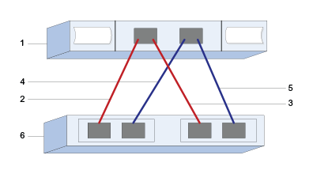

= 在 E 系列中設定 VMware 的 SAS 主機連接埠和設定
:allow-uri-read: 
:icons: font
:imagesdir: ../media/

[role="lead"]
對於SAS傳輸協定、您可以決定主機連接埠位址並進行建議的設定。

[[step-1-record-your-configuration]]
== 步驟 1：記錄您的組態

您可以產生並列印此頁面的 PDF 文件，然後使用下列工作表記錄特定於協定的儲存組態資訊。您在執行配置任務時需要這些資訊。

圖中顯示了一台主機直接連接到 E 系列儲存陣列，並採用備援連線（假設使用 4 連接埠 SAS HBA）。第一條備援連線以紅線表示；第二條備援連線以藍線表示。連接埠數量取決於主機連接埠數量。您可能只有 2 個主機連接埠。在這種情況下，建議至少採用第一條備援連線。

[[host-identifiers]]
=== 主機識別碼

|===
| 標註編號 | 主機（啟動器）連接埠連線 | SAS位址 

 a| 
1.
 a| 
主機
 a| 
_不適用_

 a| 
2.
 a| 
連接至控制器A連接埠1的主機（啟動器）連接埠1
 a| 

 a| 
3.
 a| 
主機（啟動器）連接埠2連接至控制器B、連接埠1
 a| 

 a| 
4.
 a| 
主機（啟動器）連接埠 3 連接到控制器 A 的連接埠 1
 a| 

 a| 
5.
 a| 
主機（啟動器）連接埠 4 連接到控制器 B 的連接埠 1
 a| 

|===

[[host-mapping-information]]
=== 主機對應資訊

[cols="35h,~"]
|===
| 對應主機名稱 |  

| 主機作業系統類型 |  
|===

[[step-2-determine-sas-host-identifiers]]
== 步驟 2：確定 SAS 主機識別符

使用 esxcli 或 HBA 工具尋找 SAS 位址。

.關於這項工作
檢閱HBA公用程式的準則：

* 大多數HBA廠商都提供HBA公用程式。

.步驟
. 使用 SSH 或 ESXi shell 連線到 ESXi 主機。若要啟用 ESXi shell，請參閱 https://knowledge.broadcom.com/external/article/311213/using-esxi-shell-in-esxi.html["在 ESXi 中使用 ESXi Shell"^]。
. 執行下列命令：
+
[listing]
----
esxcli storage core adapter list
----
. 記錄啟動器 SAS 位址識別碼（UID，格式為 - sas.<SAS_Address>）。輸出將類似於此範例：
+
[listing]
----
HBA Name  Driver       Link State  UID                   Capabilities         Description
--------  ----------   ----------  --------------------  -------------------  -----------
vmhba1    lsi_msgpt35  link-n/a    sas.5b083fe0ca0e7000                       (0000:03:00.0) Avago (LSI Logic) SAS3008 12Gbps SAS HBA external
----

在上面的範例中，UID 只會顯示基本 SAS 位址。對於其他連接埠，前 14 個字元保持不變，只有最後兩個字元會變化以代表不同的連接埠。通常，每個連接埠的最後一位數字都會遞增 1。在主機對映期間，通常只需知道基本 SAS 位址即可識別主機介面卡，因為 E 系列陣列會自動偵測並列出其他連接埠的 SAS 位址以供選擇。使用廠商的 HBA 工具可能有助於取得每個連接埠的 SAS 位址。

NOTE: 另一個命令選項是 `esxcli storage san sas list`。這將顯示更多詳細資訊以及以冒號分隔的十六進位格式的基本 SAS 位址。
