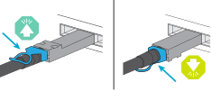
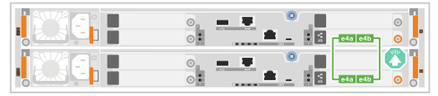
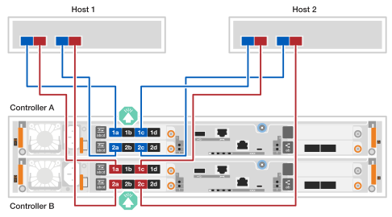
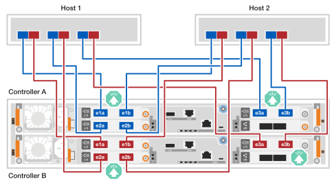
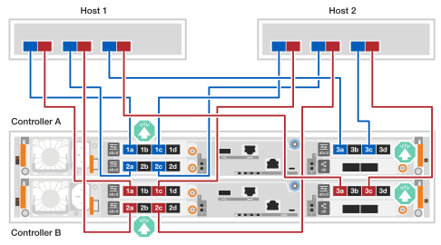
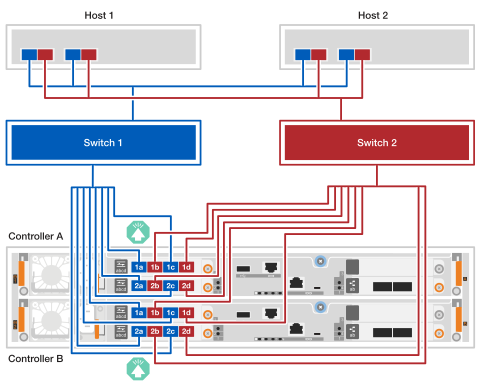
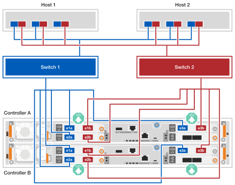
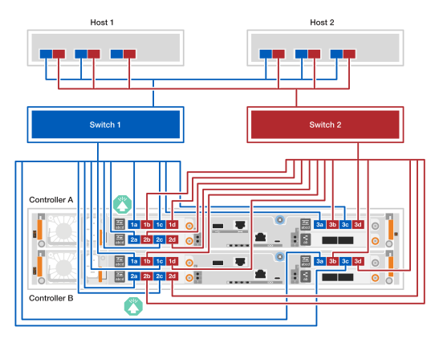
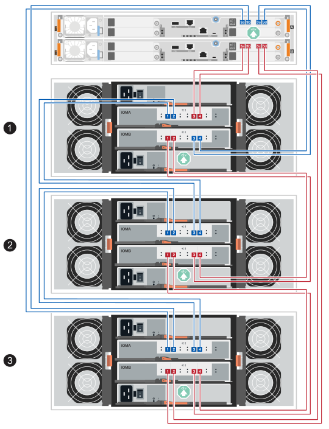

= 連接硬體線 - EF50 和 EF80
:allow-uri-read: 
:icons: font
:imagesdir: ../media/

[role="lead"]
安裝 EF50 或 EF80 儲存系統硬體後，請連接控制器間鏡射、主機網路連線以及 SAS 機櫃（如果適用的話）。（您稍後會在「完成儲存系統設定」一節中連接管理連接埠。）

.關於這項工作
* 在本程序中，術語 _I/O 模組_ 指的是主機介面卡 (HIC)。
* 線纜圖示中帶有箭頭圖標，指示將連接器插入連接埠時線纜連接器拉片的正確方向（向上或向下）。
+
插入連接器時，應該可以感覺到它咔嗒一聲到位；如果沒有感覺到咔嗒聲，請將其取出，翻轉過來再試一次。

+

[[step-1-cable-the-inter-controller-mirroring-connections]]
== 步驟 1：連接控制器間鏡像連接線

將控制器彼此連接，以實現控制器間鏡像。控制器間鏡像連接可確保系統完全冗餘，並用於快取鏡像和 I/O 傳輸。EF50 和 EF80 儲存系統的佈線方式相同。

NOTE: 無論儲存系統中安裝的控制器間鏡像 I/O 模組的速度是 100 GbE 還是 200 GbE（取決於儲存系統的支援情況），您都應使用隨附的 200 GbE 線纜。如果控制器間鏡像 I/O 模組的速度為 100 GbE，則連線將以較低的速度（100 GbE）運作。

.步驟
. 將控制器連接在一起：
+
.. 將纜線 controller A port e4a 連接至 controller B port e4a。
.. 將纜線控制器 A 連接埠 e4b 連接至控制器 B 連接埠 e4b 。
+
*200 GbE 乙太網路線*

+

+

[[step-2-cable-the-host-connections]]
== 步驟 2：連接主機線纜

根據您的網路拓撲結構（直連或光纖連接）為儲存系統連接主機。

.關於這項工作
* 根據您的儲存系統型號和運行的 SANtricity 版本，支援的主機 I/O 模組類型有所不同。本程序中的佈線範例展示了乙太網路和 Fibre Channel （FC） 主機 I/O 模組。
+
若要查看儲存系統型號支援的所有主機 I/O 模組和插槽優先順序，請參閱 link:https://hwu.netapp.com["NetApp Hardware Universe"^]。

* 佈線範例未顯示主機 1 和主機 2 中的 4 連接埠 64Gb FC HBA；但是，如果您安裝了這些 HBA，則您可以按照 2 連接埠 HBA 所示的相同方式連接每隔一個連接埠。

[role="tabbed-block"]
====
.直接連接拓撲
--
以下範例展示如何使用直接連接拓撲將儲存系統連接到主機。

.EF50 配備兩個 4 連接埠 64Gb FC I/O 模組
[%collapsible]
=====
.關於這項工作
* 佈線範例顯示了插槽 1 和插槽 2 中的主機 I/O 模組。這是 EF50 儲存系統支援的最大主機 I/O 模組數量。但是,只需要插槽 1 中的主機 I/O 模組;插槽 2 中的主機 I/O 模組是可選的。
+
如果您的儲存系統安裝了一個主機 I/O 模組，您可以忽略連接到其他主機 I/O 模組的線纜，只需連接到已安裝的主機 I/O 模組即可。

* 直連儲存系統具有兩條獨立的冗餘路徑：路徑 A 和路徑 B。
+
** 路徑 A 的連接方式以藍色線材和主機及控制器上的藍色連接埠表示。它將每台主機上的 HBA 連接埠連接到控制器 A 連接埠 a 和 c。
** 路徑 B 的連接方式以紅色線纜和主機及控制器上的紅色連接埠表示。它將每台主機上的 HBA 連接埠連接到控制器 B 連接埠 a 和 c。

* 雖然佈線範例顯示 I/O 模組連接埠 a 和 c 連接到主機，但您可以使用連接埠 a 和 b 或連接埠 c 和 d。

.步驟
. 將主機連接到控制器：
+
.. 將主機 1 路徑 A （藍色） HBA 連接埠連接到控制器 A 的 a 連接埠 （1a 和 2a）。
.. 將主機 1 的 B 路徑（紅色）HBA 連接埠連接到控制器 B 的 a 連接埠（1a 和 2a）。
.. 將主機 2 路徑 A （藍色） HBA 連接埠連接到控制器 A 的 c 連接埠（1c 和 2c）。
.. 將主機 2 路徑 B （紅色） HBA 連接埠連接到控制器 B 的 c 連接埠 （1c 和 2c）。
+
*64 Gb/s FC 纜線*

+

+

=====
.EF80 配備三個 2 連接埠 200 GbE I/O 模組
[%collapsible]
=====
.關於這項工作
* 佈線範例顯示了位於插槽 1、2 和 3 的主機 I/O 模組。這是 EF80 儲存系統支援的最大主機 I/O 模組數量。但是，僅插槽 1 中的主機 I/O 模組是必要的；插槽 2 和插槽 3 中的主機 I/O 模組均為選購。
+
如果您的儲存系統安裝的主機 I/O 模組較少，您可以忽略連接到其他主機 I/O 模組的纜線，只需連接到已安裝的主機 I/O 模組即可。

* 直連儲存系統具有兩條獨立的冗餘路徑：路徑 A 和路徑 B。
+
** 路徑 A 的連接方式以藍色線材和主機及控制器上的藍色連接埠表示。它將每台主機上的 HBA 連接埠連接到控制器 A 連接埠 a 和 b。
** 路徑 B 的連接方式以紅色線纜和主機及控制器上的紅色連接埠表示。它將每台主機上的 HBA 連接埠連接到控制器 B 連接埠 a 和 b。

.步驟
. 將主機連接到控制器：
+
.. 將主機 1 路徑 A（藍色）HBA 連接埠連接至控制器 A 的 a 連接埠（e1a、e2a 和 e3a）。
.. 將主機 1 路徑 B（紅色）HBA 連接埠連接至控制器 B 的 a 連接埠（e1a、e2a 和 e3a）。
.. 將主機 2 路徑 A（藍色）HBA 連接埠連接至控制器 A 的 b 連接埠（e1b、e2b 和 e3b）。
.. 將主機 2 路徑 B（紅色）HBA 連接埠連接至控制器 B 的 b 連接埠（e1b、e2b 和 e3b）。
+
*200 GbE 電纜*

+

+

=====
.EF80 配備三個 4 埠 64Gb FC I/O 模組
[%collapsible]
=====
.關於這項工作
* 佈線範例顯示了位於插槽 1、2 和 3 的主機 I/O 模組。這是 EF80 儲存系統支援的最大主機 I/O 模組數量。但是，僅插槽 1 中的主機 I/O 模組是必要的；插槽 2 和插槽 3 中的主機 I/O 模組均為選購。
+
如果您的儲存系統安裝的主機 I/O 模組較少，您可以忽略連接到其他主機 I/O 模組的纜線，只需連接到已安裝的主機 I/O 模組即可。

* 直連儲存系統具有兩條獨立的冗餘路徑：路徑 A 和路徑 B。
+
** 路徑 A 的連接方式以藍色線材和主機及控制器上的藍色連接埠表示。它將每台主機上的 HBA 連接埠連接到控制器 A 連接埠 a 和 c。
** 路徑 B 的連接方式以紅色線纜和主機及控制器上的紅色連接埠表示。它將每台主機上的 HBA 連接埠連接到控制器 B 連接埠 a 和 c。

* 雖然佈線範例顯示 I/O 模組連接埠 a 和 c 連接到主機，但您可以使用連接埠 a 和 b 或連接埠 c 和 d。

.步驟
. 將主機連接到控制器：
+
.. 將主機 1 路徑 A（藍色）HBA 連接埠連接至控制器 A 的 a 連接埠（1a、2a 和 3a）。
.. 將主機 1 的 B 路徑（紅色）HBA 連接埠連接到控制器 B 的 a 連接埠（1a、2a 和 3a）。
.. 將主機 2 路徑 A（藍色）HBA 連接埠連接至控制器 A 的 c 連接埠（1c、2c 和 3c）。
.. 將主機 2 路徑 B（紅色）HBA 連接埠連接至控制器 B 的 c 連接埠（1c、2c 和 3c）。
+
*64 Gb/s FC 纜線*

+

+

=====
--
.Fabric 附加拓撲
--
以下範例展示如何使用光纖連接拓撲將儲存系統連接到主機。

.EF50 配備兩個 4 連接埠 64Gb FC I/O 模組
[%collapsible]
=====
.關於這項工作
* 佈線範例顯示了插槽 1 和插槽 2 中的主機 I/O 模組。這是 EF50 儲存系統支援的最大主機 I/O 模組數量。但是,只需要插槽 1 中的主機 I/O 模組;插槽 2 中的主機 I/O 模組是可選的。
+
如果您的儲存系統安裝了一個主機 I/O 模組，您可以忽略連接到其他主機 I/O 模組的線纜，只需連接到已安裝的主機 I/O 模組即可。

* 光纖連接儲存系統具有兩個獨立的交換器路徑以實現備援：交換器 1 路徑和交換器 2 路徑。
+
** 交換器 1 路徑連線以藍色纜線和主機及控制器上的藍色連接埠顯示。它透過交換器 1 將每台主機上的 HBA 連接埠連接到控制器 A 和控制器 B 的 a 和 c 連接埠。
** 交換器 2 路徑連線以紅色纜線和主機及控制器上的紅色連接埠表示。它透過交換器 2 將每台主機上的 HBA 連接埠連接到控制器 A 和控制器 B 的 b 和 d 連接埠。

.步驟
. 將主機連接到交換器。
+
您可以使用交換器上的任何連接埠。

+
.. 將主機 1 和主機 2 的 HBA 連接埠透過交換器 1 路徑（藍色）連接到交換器 1。
.. 將主機 1 和主機 2 的纜線交換器 2 路徑 （紅色） HBA 連接埠連接到交換器 2。

. 將交換器連接至控制器：
+
.. 將纜線交換器 1（藍色）連接至控制器 A 的 a 和 c 連接埠（1a、2a、1c 和 2c）。
.. 將纜線交換器 1（藍色）連接至控制器 B 的 a 和 c 連接埠（1a、2a、1c 和 2c）。
.. 將纜線交換器 2（紅色）連接至控制器 A 的 b 和 d 連接埠（1b、2b、1d 和 2d）。
.. 將電纜開關 2（紅色）連接到控制器 B 的 b 和 d 連接埠（1b、2b、1d 和 2d）。
+
*64 Gb/s FC 纜線*

+

+

=====
.EF80 配備三個 2 連接埠 200 GbE I/O 模組
[%collapsible]
=====
.關於這項工作
* 佈線範例顯示了位於插槽 1、2 和 3 的主機 I/O 模組。這是 EF80 儲存系統支援的最大主機 I/O 模組數量。但是，僅插槽 1 中的主機 I/O 模組是必要的；插槽 2 和插槽 3 中的主機 I/O 模組均為選購。
+
如果您的儲存系統安裝的主機 I/O 模組較少，您可以忽略連接到其他主機 I/O 模組的纜線，只需連接到已安裝的主機 I/O 模組即可。

* 此佈線範例顯示每台主機上有三個 HBA。如果您的主機上的 HBA 少於三個，則可以忽略連接到額外 HBA 的佈線，只需連接到已安裝的 HBA 即可。
* 光纖連接儲存系統具有兩個獨立的交換器路徑以實現備援：交換器 1 路徑和交換器 2 路徑。
+
** 交換器 1 路徑連線以藍色纜線和主機及控制器上的藍色連接埠顯示。它透過交換器 1 將每台主機上的 HBA 連接埠連接到控制器 A 和控制器 B 的 a 連接埠。
** 交換器 2 路徑連線以紅色纜線和主機及控制器上的紅色連接埠表示。它透過交換器 2 將每台主機上的 HBA 連接埠連接到控制器 A 和控制器 B 的 b 連接埠。

.步驟
. 將主機連接到交換器：
+
您可以使用交換器上的任何連接埠。

+
.. 將主機 1 和主機 2 的 HBA 連接埠透過交換器 1 路徑（藍色）連接到交換器 1。
.. 將主機 1 和主機 2 的纜線交換器 2 路徑 （紅色） HBA 連接埠連接到交換器 2。

. 將交換器連接至控制器：
+
.. 將纜線交換器 1（藍色）連接至控制器 A 的 a 連接埠（e1a、e2a 和 e3a）。
.. 將纜線交換器 1（藍色）連接至控制器 B 的 a 連接埠（e1a、e2a 和 e3a）。
.. 將纜線交換器 2（紅色）連接至控制器 A 的 b 連接埠（e1b、e2b 和 e3b）。
.. 將纜線交換器 2（紅色）連接至控制器 B 的 b 連接埠（e1b、e2b 和 e3b）。
+
*200 GbE 電纜*

+

+

=====
.EF80 配備三個 4 埠 64Gb FC I/O 模組
[%collapsible]
=====
.關於這項工作
* 佈線範例顯示了位於插槽 1、2 和 3 的主機 I/O 模組。這是 EF80 儲存系統支援的最大主機 I/O 模組數量。但是，僅插槽 1 中的主機 I/O 模組是必要的；插槽 2 和插槽 3 中的主機 I/O 模組均為選購。
+
如果您的儲存系統安裝的主機 I/O 模組較少，您可以忽略連接到其他主機 I/O 模組的纜線，只需連接到已安裝的主機 I/O 模組即可。

* 此佈線範例顯示每台主機上有三個 HBA。如果您的主機上的 HBA 少於三個，則可以忽略連接到額外 HBA 的佈線，只需連接到已安裝的 HBA 即可。
* 光纖連接儲存系統具有兩個獨立的交換器路徑以實現備援：交換器 1 路徑和交換器 2 路徑。
+
** 交換器 1 路徑連線以藍色纜線和主機及控制器上的藍色連接埠顯示。它透過交換器 1 將每台主機上的 HBA 連接埠連接到控制器 A 和控制器 B 的 a 和 c 連接埠。
** 交換器 2 路徑連線以紅色纜線和主機及控制器上的紅色連接埠表示。它透過交換器 2 將每台主機上的 HBA 連接埠連接到控制器 A 和控制器 B 的 b 和 d 連接埠。

.步驟
. 將主機連接到交換器：
+
您可以使用交換器上的任何連接埠。

+
.. 將主機 1 和主機 2 的 HBA 連接埠透過交換器 1 路徑（藍色）連接到交換器 1。
.. 將主機 1 和主機 2 的纜線交換器 2 路徑 （紅色） HBA 連接埠連接到交換器 2。

. 將交換器連接至控制器：
+
.. 將纜線交換器 1（藍色）連接至控制器 A 的 a 和 c 連接埠（1a、2a、3a、1c、2c 和 3c）。
.. 將纜線交換器 1（藍色）連接至控制器 B 的 a 和 c 連接埠（1a、2a、3a、1c、2c 和 3c）。
.. 將纜線交換器 2（紅色）連接至控制器 A 的 b 和 d 連接埠（1b、2b、3b、1d、2d 和 3d）。
.. 將纜線交換器 2（紅色）連接至控制器 B 的 b 和 d 連接埠（1b、2b、3b、1d、2d 和 3d）。
+
*64 Gb/s FC 纜線*

+

+

=====
--
====

[[step-3-cable-the-sas-shelf-connections]]
== 步驟 3：連接 SAS 機櫃連接線

以下步驟顯示如何將控制器連接到一個 DE460C 機櫃或三個 DE460C 機櫃的堆疊。

.關於這項工作
* 佈線範例顯示 DE460C 機櫃；但是，相同的佈線適用於所有支援的 SAS 機櫃。請參閱 link:https://hwu.netapp.com["NetApp Hardware Universe"^] 以了解支援的 SAS 機櫃。
* 如需儲存系統支援的最大機櫃數量以及所有佈線選項（例如光纖）的相關資訊，請參閱 link:https://hwu.netapp.com["NetApp Hardware Universe"^]。
* 佈線程序顯示控制器在插槽 3 中有一個 SAS I/O 模組。這是 SANtricity 12.10 唯一支援的 SAS I/O 模組組態。
* 佈線示意圖中，藍色線表示控制器 A 的佈線，紅色線表示控制器 B 的佈線。
* 您一律將控制器與一或多個機櫃連接纜線，以便為 A 側路徑（IOMA）和 B 側路徑（IOMB）提供兩個纜線連線，如佈線圖所示。
* 您使用儲存系統隨附的儲存設備纜線，其可能是下列纜線類型：
+
*mini-SAS HD 纜線*

+

[role="tabbed-block"]
====
.選項 1：一個 DE460C 機櫃
--
將每個控制器透過電纜連接到 DE460C 機櫃上的每個 IOM12 模組，以便控制器具有到機櫃的 A 側路徑（IOMA）和 B 側路徑（IOMB）。

.步驟
. 將纜線從控制器 A 連接埠 3a 連接至機櫃 IOMA 連接埠 1。
. 將控制器 A 連接埠 3b 連接至機櫃 IOMA 連接埠 2。
. 將控制器 A 連接埠 3c 連接至機櫃 IOMB 連接埠 3。
. 將控制器 A 連接埠 3d 連接至機櫃 IOMB 連接埠 4。
. 將控制器 B 連接埠 3a 連接至機櫃 IOMA 連接埠 3。
. 將控制器 B 連接埠 3b 連接至機櫃 IOMA 連接埠 4。
. 將控制器 B 連接埠 3c 連接至機櫃 IOMB 連接埠 1。
. 將控制器 B 連接埠 3d 連接至機櫃 IOMB 連接埠 2。

完成機櫃佈線後，佈線應如下圖所示：

image:../media/drw_ef50-ef80_1_de460c_cabling_ieops-2981.svg["將控制器連接埠接線至一個 DE460C 機櫃"]

--
.選項 2：三個 DE460C 機櫃
--
將三個機櫃連接在一起（機櫃到機櫃的連接），然後將每個控制器連接到機櫃堆疊的每一端（機櫃 1 和機櫃 3），以便控制器有 A 側路徑（IOMA）和 B 側路徑（IOMB）連接到機櫃堆疊。

. 為 IOMA 路徑連接機櫃間的纜線：
+
.. 將機櫃 1 IOMA 連接埠 1 連接至機櫃 2 IOMA 連接埠 4。
.. 將機櫃 1 IOMA 連接埠 2 連接至機櫃 2 IOMA 連接埠 3。
.. 將機櫃 2 IOMA 連接埠 1 連接至機櫃 3 IOMA 連接埠 4。
.. 將機櫃 2 IOMA 連接埠 2 連接至機櫃 3 IOMA 連接埠 3。

. 為 IOMB 路徑連接機櫃間連線：
+
.. 將機櫃 1 IOMB 連接埠 1 連接至機櫃 2 IOMB 連接埠 3。
.. 將機櫃 1 IOMB 連接埠 2 連接至機櫃 2 IOMB 連接埠 4。
.. 將機櫃 2 IOMB 連接埠 1 連接至機櫃 3 IOMB 連接埠 3。
.. 將機櫃 2 的 IOMB 連接埠 2 連接至機櫃 3 的 IOMB 連接埠 4。

. 將控制器 A 連接至機櫃 3（IOMA 路徑）和 1（IOMB 路徑）：
+
.. 將控制器 A 連接埠 3a 連接至機櫃 3 IOMA 連接埠 1
.. 將控制器 A 連接埠 3b 連接至機櫃 3 IOMA 連接埠 2。
.. 將控制器 A 連接埠 3c 連接至機櫃 1 IOMB 連接埠 3。
.. 將控制器 A 連接埠 3d 連接至機櫃 1 IOMB 連接埠 4。

. 將控制器 B 連接至機櫃 1（IOMA 路徑）和 3（IOMB 路徑）：
+
.. 將控制器 B 連接埠 3a 連接至機櫃 1 IOMA 連接埠 3。
.. 將控制器 B 連接埠 3b 連接至機櫃 1 IOMA 連接埠 4。
.. 將控制器 B 連接埠 3c 連接至機櫃 3 IOMB 連接埠 1。
.. 將控制器 B 連接埠 3d 連接至機櫃 3 IOMB 連接埠 2。

完成機櫃佈線後，佈線應如下所示：

--
====
.接下來呢？
完成儲存系統的佈線後，link:install-power-hardware.html["啟動儲存系統"]。
