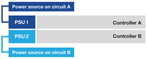

= 啟動硬體 - EF50 和 EF80
:allow-uri-read: 
:icons: font
:imagesdir: ../media/

[role="lead"]
為 EF50 或 EF80 儲存系統佈線後，請開啟機櫃電源並指派機櫃 ID（如果適用），然後開啟控制器電源。

.開始之前
採取防靜態預防措施。

[[step-1-power-on-the-shelves-and-assign-shelf-ids]]
== 步驟 1：開啟機櫃電源並指派機櫃 ID

開啟機櫃電源，然後為每個機櫃指派唯一的機櫃 ID。

.關於這項工作
* 為每個機櫃分配一個唯一的機櫃 ID，可確保該機櫃在您的儲存系統中是獨立的。
+
有效的機櫃 ID 為 01 至 99。

+
整合在控制器中的內部機櫃（儲存設備）會被指派固定的機櫃 ID 00。

* 您必須將機櫃斷電重新啟動（關閉 SAS 機櫃每個電源供應器上的電源開關，等待至少 10 秒鐘，然後重新開啟電源），機櫃 ID 才能生效。

.步驟
. 首先將電源線連接到機櫃，用電源線固定器將其固定到位，將電源線連接到不同電路上的電源，然後開啟每個電源供應（位於機櫃背面）上的電源開關，即可為機櫃開啟電源。
+
機櫃通電後會自動開啟電源並開機。

. 移除左側端蓋，即可存取面板上的橘色機櫃 ID 按鈕。
+
image::../media/drw_shelf_id_sas_ieops-2187.svg[變更 SAS 機櫃 ID]

+
[cols="20%,80%"]
|===

 a| 
image::../media/icon_round_1.png[圖說編號 1]
 a| 
機櫃端蓋

 a| 
image::../media/icon_round_2.png[［標註編號 2]
 a| 
機櫃面板

 a| 
image::../media/icon_round_3.png[［標註編號 3]
 a| 
機櫃 ID 按鈕

 a| 
image::../media/icon_round_4.png[［標註編號 4]
 a| 
機櫃 ID 編號

|===
. 更改機櫃 ID 的第一個數字：
+
.. 按住機櫃 ID 按鈕，直到數位顯示器上的第一個數字閃爍，然後版本按鈕。
+
數字閃爍最多可能需要 15 秒。這會啟動機櫃 ID 編程模式。

+

NOTE: 如果 ID 超過 15 秒才閃爍，請再次按住機櫃 ID 按鈕，確保完全按下。

.. 按下並放開機櫃 ID 按鈕以推進編號，直到達到 0 到 9 之間的所需編號。
+
每次按下和版本的持續時間最短可至一秒。

+
第一個數字持續閃爍。

. 更改機櫃 ID 的第二個數字：
+
.. 按住按鈕，直到數位顯示器上的第二個數字閃爍。
+
數字閃爍最多可能需要三秒鐘。

+
數位顯示器上的第一個數字停止閃爍。

.. 按下並放開機櫃 ID 按鈕以推進編號，直到達到 0 到 9 之間的所需編號。
+
第二個數字持續閃爍。

. 鎖定所需的編號，按住機櫃 ID 按鈕直到第二個數字停止閃爍，即可退出編程模式。
+
數字停止閃爍最多可能需要三秒鐘。

+
數位顯示器上的兩個數字開始閃爍，大約五秒鐘後琥珀色 LED 燈亮起，提醒您待處理的機櫃 ID 尚未生效。

. 將機櫃斷電重啟至少 10 秒鐘，以使機櫃 ID 生效。
+
.. 關閉每個電源供應上的電源開關。
.. 請等待 10 秒鐘。
.. 開啟每個電源供應上的電源開關，以完成電源循環。
+
電源供應接通時，雙色 LED 指示燈應亮起綠色。

. 更換左側端蓋。

[[step-2-power-on-the-controllers]]
== 步驟 2：開啟控制器電源

在將機櫃通電並指派唯一 ID 後，將控制器通電。

. 將電源線插入每個控制器電源供應器，然後將它們連接到不同電路上的電源。
+

NOTE: 如果您使用的是第三方電源分配單元（PDU），請勿使用控制器正後方的電源插座，因為這可能會阻礙對控制器的存取。

+
*電源線*

+

+

+
** 系統開始啟動。首次啟動可能需要長達八分鐘的時間。
** 系統機箱上的 LED 指示燈閃爍，風扇開始運轉，這表示控制器正在通電。
+
啟動時風扇噪音很大是正常現象。

** 系統機箱正面（擋板後方）的數位顯示器不亮。

. 使用每個電源供應器上的固定裝置固定電源線。

.接下來呢？
啟動儲存系統後，link:install-complete-setup.html["完整的儲存系統設定"]。
