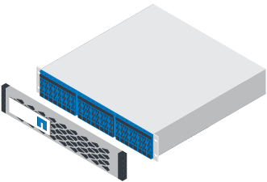
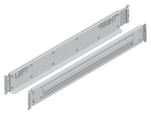
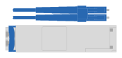
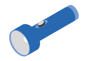
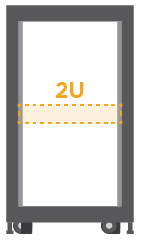

= 準備安裝您的 EF300 或 EF600 儲存系統
:allow-uri-read: 
:icons: font
:imagesdir: ../media/

[role="lead"]
瞭解如何準備安裝 EF300 ， EF600 ， EF300C 或 EF600C 系列儲存系統。

.開始之前
如果您要將EF300纜線連接至SAS擴充、請檢閱下列資訊：

* link:../maintenance-ef600/sas-add-supertask-task.html["新增SAS擴充卡"^] 用於SAS擴充卡安裝。
* link:../install-hw-cabling/index.html["纜線配置總覽"] 適用於SAS擴充纜線。

.步驟
. 註冊您的系統：
+

NOTE: 您可以現在註冊系統，也可以稍後再註冊。稍後，系統啟動時，系統會提示您註冊系統。

+
.. 如果您還沒有帳戶，請至 http://mysupport.netapp.com/["NetApp支援"^]建立帳戶。
.. 請依照 NetApp 知識庫文章中的說明註冊您的系統 https://kb.netapp.com/nss/System_Registration/How_to_register_a_new_system_on_the_NetApp_Support_Site["如何註冊新系統"^]。

. 確認您收到的包裝盒中有下列項目。
+
|===

 a| 

 a| 
安裝磁碟機的磁碟櫃（擋板和端蓋分開包裝）

 a| 

 a| 
機架安裝硬體

|===
+
下表列出您可能會收到的纜線類型。如果您收到的纜線未列於表中，請參閱 link:https://hwu.netapp.com["NetApp Hardware Universe"^] 以尋找該纜線並確定其用途。

+
|===
| 連接器類型 | 纜線類型 | 使用 

 a| 

 a| 
RJ-45乙太網路纜線（如有訂購）
 a| 
管理連線

 a| 

 a| 
I/O纜線（如有訂購）
 a| 
資料主機佈線

 a| 

 a| 
電源線（如有訂購）
 a| 
開啟儲存系統電源

|===
. 請務必提供下列項目。
+
|===

 a| 

 a| 
2號十字螺絲起子

 a| 

 a| 
手電筒

 a| 

 a| 
防靜電繫帶

 a| 

 a| 
2U機架空間：標準19吋（48.30公分）機架、可容納2U機櫃、尺寸如下。

*深度*：19.0英寸（48.3公分）

*寬度*：17.6吋（44.7公分）

*高度*：3.34英吋（8.48公分）

*機櫃*：24個磁碟機

*最大重量*：60.5磅（27.4公斤）

NOTE: 使用協力廠商機櫃可能會導致電源線限制控制器的存取。

 a| 

 a| 
管理軟體支援的瀏覽器：

** Google Chrome （第 89 版及更新版本）
** Microsoft Edge （ 90 及更新版本）
** Mozilla Firefox （ 80 版及更新版本）
** Safari （版本 14 及更新版本）

|===

